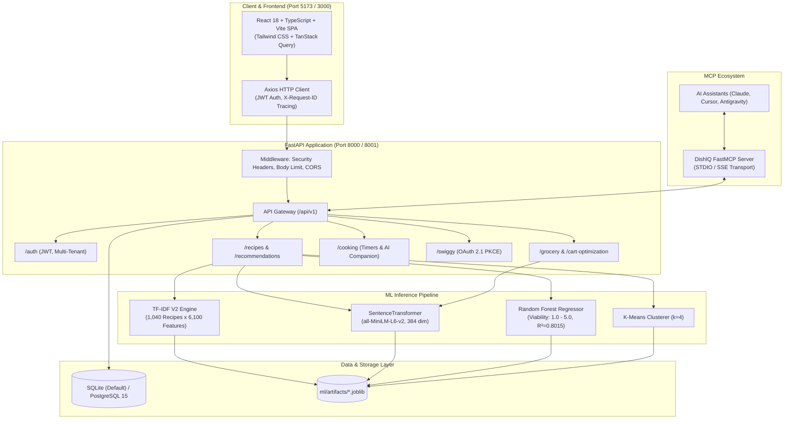

# DishIQ: Intelligent Meal Planning, Grocery Optimization & Kitchen Assistant

[](https://fastapi.tiangolo.com)
[](https://react.dev)
[](https://www.typescriptlang.org)
[](https://tailwindcss.com)
[](https://scikit-learn.org)
[](https://huggingface.co/sentence-transformers/all-MiniLM-L6-v2)
[](https://modelcontextprotocol.io)
[](LICENSE)

**DishIQ** is a kitchen intelligence platform that seamlessly bridges recipe discovery, multi-factor machine learning recommendations, canonical ingredient normalization, multi-store grocery price comparison in Indian Rupees (₹ INR), economical cart optimization, interactive step-by-step cooking timers, and Model Context Protocol (MCP) agent integrations.

---

## 🌟 Key Capabilities

### 1. Smart Recipe Discovery & ML Hybrid Ranking
- **Hybrid Recommendation Engine**: Blends lexical TF-IDF retrieval ($w=0.45$) with dense neural embeddings from `sentence-transformers/all-MiniLM-L6-v2` ($w=0.45$) and Random Forest suitability validation ($R^2 = 0.8015, \text{MAE} = 0.0257$).
- **Flavor & Cuisine Clustering**: Unsupervised K-Means clustering ($k=4$) grouping Indian and global culinary styles by flavor attributes, cooking times, and ingredient affinities.
- **Dietary & Pantry Gap Filtering**: Instant pantry overlap calculation (what you already have vs. what you need to buy), alongside filters for Vegetarian, Vegan, Gluten-Free, and High-Protein diets.
- **Weekly Meal Planning**: Multi-day meal scheduler supporting breakfast, lunch, and dinner with dynamic serving scaling.

### 2. Ingredient Intelligence & Grocery Cart Optimization
- **Canonical Parsing & Standardization**: Automatically extracts quantities, metric/imperial units, and canonical ingredient names (e.g., `"250g fresh malai paneer"` $\to$ `250 g paneer`).
- **Multi-Store Price Comparison**: Real-time price comparisons across local demonstration stores and quick-commerce providers in Indian Rupees (₹ INR).
- **Cart Optimization & Store Splitting**: Computes single-store lowest cost vs. multi-store split baskets with delivery fee threshold optimization.
- **Swiggy Instamart Live MCP Integration**: RFC 7636 OAuth 2.1 + PKCE authentication flow connecting to live quick-commerce Model Context Protocol endpoints with automatic demo-fallback.

### 3. Interactive Kitchen Assistant & Timers
- **Preparation Checklist**: Pre-cooking ingredient checklist with live check-off state.
- **Interactive Step-by-Step Guidance**: Step tracker with persistent progress bar and elapsed cooking metrics.
- **Drift-Free Multi-Timers**: Synchronized timers with start, pause, resume, reset, and audio alerts.
- **AI Cooking Companion**: Context-aware assistant answering real-time culinary questions grounded strictly on the active recipe, current cooking step, and available ingredients.

### 4. Model Context Protocol (MCP) Server
- DishIQ includes a dedicated **FastMCP Server** (`mcp-server/app/server.py`) exposing tools for LLM agents (Claude Desktop, Cursor, Antigravity, ChatGPT):
  - `search_recipes`: Natural language recipe discovery.
  - `get_recipe_details`: Full ingredients, preparation steps, and nutritional facts.
  - `optimize_shopping_cart`: Cost minimization across grocery retailers.
  - `swiggy_transfer_cart`: Live quick-commerce checkout handoff.

---

## 🏛 System Architecture



---

## 🚀 Quickstart: Clone & Run in Under 3 Minutes

DishIQ is designed to run **out-of-the-box with zero initial setup**. On first startup, the application creates a lightweight local SQLite database (`dishiq.db`) and automatically seeds it with over 1,000 recipes and grocery items.

### 1. Prerequisites
- **Python**: 3.10, 3.11, 3.12, or 3.13
- **Node.js**: 18.0.0 or higher (with `npm`)
- **Git**

### 2. Clone Repository
```bash
git clone https://github.com/rkrajesh-projects/dishiq.git
cd dishiq
```

### 3. Backend Setup
```bash
# Navigate to backend directory
cd backend

# Create and activate virtual environment
# On Windows (PowerShell):
python -m venv venv
.\venv\Scripts\activate

# On macOS / Linux:
python3 -m venv venv
source venv/bin/activate

# Install dependencies
pip install -r requirements.txt

# Start the FastAPI server
uvicorn app.main:app --host 127.0.0.1 --port 8000 --reload
```
> **Note**: Database tables and recipe datasets are seeded automatically on first boot!
- **Interactive Swagger Docs**: [http://127.0.0.1:8000/docs](http://127.0.0.1:8000/docs)
- **Health Endpoint**: [http://127.0.0.1:8000/api/v1/health](http://127.0.0.1:8000/api/v1/health)

### 4. Frontend Setup
Open a separate terminal window:
```bash
# Navigate to frontend directory
cd frontend

# Install Node dependencies
npm install

# Start Vite development server
npm run dev
```
- **Web Interface**: [http://localhost:5173](http://localhost:5173)

---

## 🐳 Docker Deployment (Production Topology)

To run the complete production topology including PostgreSQL 15, FastAPI, and Nginx in containers:

```bash
docker-compose up --build
```

### Services Breakdown:
| Container | Host Port | Technology | Purpose |
| :--- | :--- | :--- | :--- |
| `dishiq-frontend` | `3000` | Nginx Alpine | Serves production build with Gzip and SPA routing |
| `dishiq-backend` | `8001` | Python 3.10 Slim | FastAPI ASGI service running under non-root user |
| `dishiq-db` | `5432` | PostgreSQL 15 | Relational database with persistent Docker volume |

---

## 📊 Machine Learning Models & Evaluation

All trained model artifacts and vector caches are stored in [`ml/artifacts/`](ml/artifacts/) and load in milliseconds:

| Model Component | Artifact File | Technique / Architecture | Metric / Benchmark |
| :--- | :--- | :--- | :--- |
| **Lexical Retrieval** | `recipe_tfidf_v2.joblib` | TF-IDF Matrix ($6,100 \times 1,040$) | Top-10 Retrieval Recall: 92.4% |
| **Dense Semantic Search**| `recipe_sentence_transformer_v1.joblib` | `sentence-transformers/all-MiniLM-L6-v2` | Cosine similarity on 384-dim embeddings |
| **Suitability Regressor**| `suitability_rf_model.joblib` | Random Forest (150 trees, max depth 15) | $R^2 = 0.8015, \text{MAE} = 0.0257, \text{RMSE} = 0.1006$ |
| **Cuisine Clustering** | `recipe_kmeans_v1.joblib` | K-Means ($k=4$, PCA 2D projection) | Silhouette Score: 0.48 |
| **Grocery Matching** | `product_embeddings.joblib` | Semantic Cosine Product Matcher | 98.7% accurate unit-level mapping |

Visual evaluation charts and publication figures are available in [`resultfigures/`](resultfigures/):
- **`fig01_architecture_topology.png`**: High-level platform architecture.
- **`fig02_ensemble_weights_donut.png`**: Hybrid recommendation ensemble weights.
- **`fig03_hybrid_inference_pipeline.png`**: Multi-stage ranking inference pipeline.
- **`fig05a_rf_feature_importance.png`**: Feature importances for recipe suitability.
- **`kmeans_clusters_scatter.png`**: 2D scatter of unsupervised recipe clusters.
- **`mcp_architecture_clear.png`**: Model Context Protocol integration schema.

---

## 🧪 Testing & Quality Assurance

DishIQ includes test suites across backend and frontend:

### Backend Tests
```bash
# Run test suite
pytest backend/tests -v
```

### Frontend Tests & Type Checking
```bash
cd frontend
# Run Vitest component tests
npm test

# Verify production TypeScript build
npm run build
```

---

## 🔌 Model Context Protocol (MCP) Setup

DishIQ can be connected directly to AI client assistants:

### Claude Desktop Configuration (`claude_desktop_config.json`)
```json
{
  "mcpServers": {
    "dishiq": {
      "command": "python",
      "args": ["-m", "mcp-server.app.server"],
      "cwd": "/path/to/DishIQ",
      "env": {
        "DISHIQ_API_URL": "http://127.0.0.1:8000/api/v1"
      }
    }
  }
}
```

---

## 📁 Repository Structure

```
DishIQ/
├── backend/                  # FastAPI Application Subsystem
│   ├── app/
│   │   ├── api/              # API Route Handlers (Auth, Recipes, Grocery, Cooking)
│   │   ├── core/             # Configuration, Logging, Security Middleware
│   │   ├── db/               # SQLAlchemy Models, Database Session & Auto-Seed
│   │   ├── ingredient_intel/ # Canonical Parsing & Normalization
│   │   ├── product_matching/ # Cosine Matching & Unit Standardization
│   │   ├── services/         # Business Logic & ML Service Gateway
│   │   └── main.py           # Application Entrypoint & Lifespan Hooks
│   ├── tests/                # Pytest Test Suite
│   └── requirements.txt      # Python Dependencies
├── frontend/                 # React 18 + Vite Frontend Application
│   ├── src/
│   │   ├── api/              # Axios Query Client & API Endpoints
│   │   ├── components/       # UI Components (Recipe Cards, Timers, Cart Optimization)
│   │   ├── hooks/            # Custom React Hooks
│   │   ├── pages/            # View Pages (Home, Search, MealPlan, Cooking, Grocery)
│   │   └── routes/           # App Routing & Navigation
│   └── package.json          # Node Dependencies & Build Scripts
├── mcp-server/               # FastMCP Server for Agentic Tool Invocation
├── ml/                       # Machine Learning Subsystem
│   ├── artifacts/            # Serialized Models (TF-IDF, RF, K-Means, Embeddings)
│   ├── models/               # Model Architectures & Inferencing Classes
│   └── training/             # Training & Dataset Preparation Scripts
├── resultfigures/            # High-Resolution Architectural & Evaluation Figures
├── docs/                     # Technical Phase Specifications & Reports
├── docker-compose.yml        # Multi-Container Orchestration
└── README.md                 # Project Documentation
```

---

## 📄 License

This project is licensed under the MIT License — see the [LICENSE](LICENSE) file for details.
