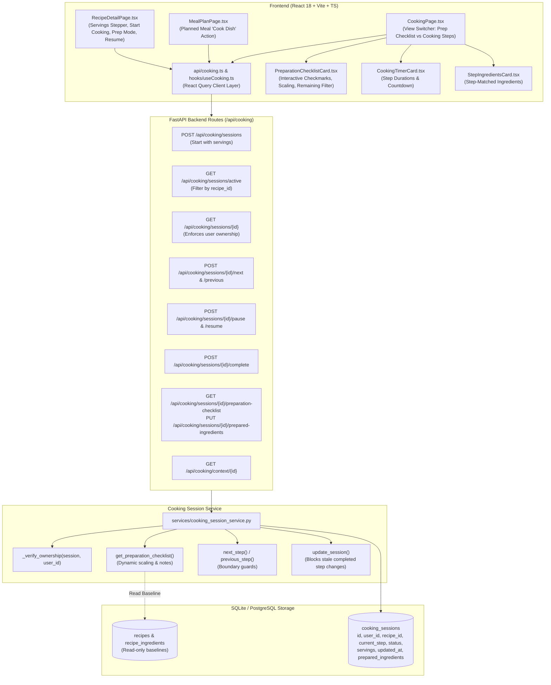

# DishIQ — Phase 10: Kitchen Assistant — Preparation and Interactive Cooking Report

## 1. Executive Summary and Phase Objectives

Phase 10 (**Kitchen Assistant — Preparation and Interactive Cooking**) has been successfully implemented, verified, and audited for the **DishIQ** project (`D:\DishIQ`).

### 1.1 Phase Objectives
The core objective of Phase 10 is to deliver a reliable, interactive cooking assistant connecting DishIQ's existing recipe catalogue, ingredient normalization, and meal planning capabilities into an intuitive kitchen experience:

$$\text{Choose Recipe} \longrightarrow \text{Review Ingredients} \longrightarrow \text{Prepare Ingredients (Mise en Place)} \longrightarrow \text{Start Cooking} \longrightarrow \text{Follow Step-by-Step} \longrightarrow \text{Track Progress} \longrightarrow \text{Finish Session}$$

### 1.2 Core Constraints Respected
- **Strict Content & Instruction Integrity**: Recipe instructions, cooking times, and ingredient descriptions are preserved from verified sources. No fictitious steps, temperatures, or quantities are manufactured.
- **Recipe Baseline Immutability**: Serving scaling dynamically recalculates derived quantities for the cooking session without mutating underlying database recipe definitions.
- **Session Progress Persistence**: Step navigation, preparation checklist states, and pause/resume lifecycle are reliably stored and restored across reloads.
- **Tenant Isolation & Security**: User ownership is enforced on all private session reads, updates, and navigation requests. Unauthorized cross-user requests are blocked with HTTP 403 Forbidden.
- **Zero Premature Ordering or Pantry Mutation**: No grocery ordering or checkout occurs, and pantry stock is not altered by entering or finishing a cooking session.
- **Zero Regressions**: 100% preservation of Phases 1–9 capabilities, including Swiggy Instamart OAuth 2.1 PKCE, ML pipelines, grocery price comparison, and meal planning.

---

## 2. Existing Kitchen Assistant Functionality and Baseline

Prior to Phase 10:
- **Baseline Tables**: `cooking_sessions` table existed with columns `(id, user_id, recipe_id, current_step, status, started_at, completed_at, notes)`.
- **Baseline Services**: `CookingSessionService` supported basic `next_step` and `previous_step` operations.
- **Baseline Frontend**: `CookingPage.tsx` displayed instruction text and basic progress bar, but lacked:
  - Persistent ingredient preparation checklist mode (*mise en place*).
  - Explicit session serving count tracking and derived ingredient scaling.
  - User ownership enforcement across session endpoints.
  - Stale step update protection on completed sessions.
  - Pause and resume session controls.
  - "Resume Cooking" integration on `RecipeDetailPage` and "Cook Dish" on `MealPlanPage`.

---

## 3. Actual Architecture and Data Flow



---

## 4. Cooking-Session Model and Lifecycle

### 4.1 Enhanced Model Definition
In [`backend/app/models/cooking_session.py`](file:///d:/DishIQ/backend/app/models/cooking_session.py):
- `id: str` (UUID PK)
- `user_id: str` (FK to `users.id`, indexed)
- `recipe_id: str` (FK to `recipes.id`, indexed)
- `current_step: int` (Default: 0; Check constraint: `current_step >= 0`)
- `status: str` (Default: `active`; Allowed: `active`, `paused`, `completed`)
- `servings: Optional[int]` (Check constraint: `servings IS NULL OR servings > 0`)
- `prepared_ingredients: Optional[List[str]]` (JSON array of prepared ingredient keys)
- `started_at: datetime` (UTC timestamp)
- `updated_at: Optional[datetime]` (UTC timestamp updated on meaningful transitions)
- `completed_at: Optional[datetime]` (UTC timestamp populated upon completion)
- `notes: Optional[str]`

### 4.2 Lifecycle State Transitions
- **`active`**: Cooking or preparing in progress. Navigation is enabled.
- **`paused`**: User paused cooking. Step progress and prepared ingredients are safely preserved.
- **`completed`**: Cooking finished. `completed_at` is set. Step navigation is locked (`SESSION_COMPLETED`), and stale step updates are rejected with HTTP 400.

---

## 5. Ingredient Checklist and Serving-Scaling Behavior

Implemented in [`PreparationChecklistCard.tsx`](file:///d:/DishIQ/frontend/src/components/recipe/PreparationChecklistCard.tsx) and [`cooking_session_service.py`](file:///d:/DishIQ/backend/app/services/cooking_session_service.py):

### 5.1 Dynamic Quantity Scaling
For any recipe ingredient with baseline quantity $Q_{\text{base}}$ and baseline servings $S_{\text{recipe}}$:
$$\text{Scale Factor} = \frac{S_{\text{session}}}{S_{\text{recipe}}}$$
$$Q_{\text{scaled}} = Q_{\text{base}} \times \text{Scale Factor}$$
- **Non-Numeric / Qualitative Protection**: Ingredients flagged with "to taste", "as needed", or "optional" preserve qualitative descriptions without numeric distortion.
- **Recipe Immutability**: Quantities scale dynamically for display and preparation tracking; the underlying `recipes` and `recipe_ingredients` records remain unmodified.

### 5.2 Preparation Checklist Features (*Mise en Place*)
- **Per-Ingredient Checkboxes**: Mark and unmark ingredients as prepared with immediate visual line-through and state persistence.
- **Preparation Notes Display**: Retains culinary notes such as *cubed*, *sliced*, *finely chopped*, or *minced*.
- **Remaining Filter**: Toggle between "All Ingredients" and "Remaining (Unprepared) Only".
- **Bulk Action**: "Mark All Prepared" for fast kitchen workflows.
- **Persistence**: Calling `PUT /api/cooking/sessions/{id}/prepared-ingredients` stores `prepared_ingredients` on the session record, ensuring state persists across page reloads.

---

## 6. Instruction Navigation and Progress Persistence

Implemented in [`CookingPage.tsx`](file:///d:/DishIQ/frontend/src/pages/CookingPage.tsx):
1. **Deterministic Step Navigation**:
   - `Previous Step`: Decrements `current_step` with boundary clamp at 0.
   - `Next Step`: Increments `current_step` with boundary clamp at `total_steps - 1`.
   - `Complete Cooking`: Replaces Next Step on final instruction; marks session complete and displays completion summary.
2. **Step Completion Checklist**:
   - Allows marking specific steps as completed (`Mark Step Complete` / `Step Completed (Mark Incomplete)`).
   - Updates timeline progress markers and overall completion percentage.
3. **Timer Safety Guard**:
   - Navigating away from a step while a timer is counting down prompts for explicit confirmation.
4. **Stale / Duplicate Protection**:
   - Navigation buttons disable while mutations are pending (`disabled={isNavigating}`).
   - Completed sessions cannot have step indexes rolled back by stale requests.

---

## 7. API Routes Created or Modified

| Method | Path | Description | Response Status |
|---|---|---|---|
| `POST` | `/api/cooking/sessions` | Starts cooking session with optional `servings` and `notes` | `201 Created` |
| `GET` | `/api/cooking/sessions/active` | Retrieves active/paused session, optionally filtered by `recipe_id` | `200 OK` |
| `GET` | `/api/cooking/sessions/{id}` | Retrieves session details with tenant ownership enforcement | `200 OK` / `403` / `404` |
| `PUT` / `PATCH` | `/api/cooking/sessions/{id}` | Updates step, status, servings, notes, or prepared ingredients | `200 OK` / `400` / `403` |
| `POST` | `/api/cooking/sessions/{id}/next` | Advances to next step | `200 OK` / `400` / `403` |
| `POST` | `/api/cooking/sessions/{id}/previous` | Returns to previous step | `200 OK` / `400` / `403` |
| `POST` | `/api/cooking/sessions/{id}/pause` | Pauses cooking session | `200 OK` / `400` / `403` |
| `POST` | `/api/cooking/sessions/{id}/resume` | Resumes paused cooking session | `200 OK` / `400` / `403` |
| `POST` | `/api/cooking/sessions/{id}/complete` | Marks session complete | `200 OK` / `403` / `404` |
| `GET` | `/api/cooking/sessions/{id}/preparation-checklist` | Returns scaled ingredients, preparation notes, and prepared state | `200 OK` / `403` / `404` |
| `PUT` | `/api/cooking/sessions/{id}/prepared-ingredients` | Persists list of prepared ingredient keys | `200 OK` / `403` / `404` |
| `GET` | `/api/cooking/context/{id}` | Returns rich structured cooking context | `200 OK` / `403` / `404` |

---

## 8. Frontend Components Created or Modified

| File | Status | Description |
|---|---|---|
| [`frontend/src/types/cooking.ts`](file:///d:/DishIQ/frontend/src/types/cooking.ts) | Modified | Added `servings`, `updated_at`, `prepared_ingredients`, `PreparationItem`, `PreparationChecklist` |
| [`frontend/src/api/cooking.ts`](file:///d:/DishIQ/frontend/src/api/cooking.ts) | Modified | Added `pauseCookingSession`, `resumeCookingSession`, `getPreparationChecklist`, `updatePreparedIngredients` |
| [`frontend/src/hooks/useCooking.ts`](file:///d:/DishIQ/frontend/src/hooks/useCooking.ts) | Modified | Added React Query hooks for checklist, pause, resume, and prepared ingredients |
| [`frontend/src/components/recipe/PreparationChecklistCard.tsx`](file:///d:/DishIQ/frontend/src/components/recipe/PreparationChecklistCard.tsx) | Created | Interactive preparation checklist component with scaled quantities, filters, and checkboxes |
| [`frontend/src/pages/CookingPage.tsx`](file:///d:/DishIQ/frontend/src/pages/CookingPage.tsx) | Modified | Integrated view switcher (Prep Checklist vs Cooking Steps), pause/resume buttons, scaled sidebar quantities |
| [`frontend/src/pages/RecipeDetailPage.tsx`](file:///d:/DishIQ/frontend/src/pages/RecipeDetailPage.tsx) | Modified | Added "Resume Cooking (Step X)" button, Prep Checklist launcher, and serving pass-through |
| [`frontend/src/pages/MealPlanPage.tsx`](file:///d:/DishIQ/frontend/src/pages/MealPlanPage.tsx) | Modified | Added "Cook Dish" button to planned meal cards with planned serving counts |
| [`frontend/src/__tests__/Phase10KitchenAssistant.test.tsx`](file:///d:/DishIQ/frontend/src/__tests__/Phase10KitchenAssistant.test.tsx) | Created | 7 dedicated Vitest automated tests for Phase 10 |
| [`frontend/src/__tests__/CookingPage.test.tsx`](file:///d:/DishIQ/frontend/src/__tests__/CookingPage.test.tsx) | Modified | Updated mock hooks to include new Phase 10 exports |
| [`frontend/src/__tests__/RecipeDetailPage.test.tsx`](file:///d:/DishIQ/frontend/src/__tests__/RecipeDetailPage.test.tsx) | Modified | Updated mock hooks for active session support |

---

## 9. Database Migrations and Safety Status

### 9.1 Migration `006_cooking_session_enhancements.py`
Created in [`backend/alembic/versions/006_cooking_session_enhancements.py`](file:///d:/DishIQ/backend/alembic/versions/006_cooking_session_enhancements.py):
- Added columns to `cooking_sessions`:
  - `servings` (`Integer`, nullable=True)
  - `updated_at` (`DateTime(timezone=True)`, nullable=True)
  - `prepared_ingredients` (`JSON`, nullable=True)
- Applied cleanly to both `backend/dishiq.db` and root `dishiq.db`.
- Check constraint `chk_cooking_session_servings_positive` enforces `servings IS NULL OR servings > 0`.
- Downgrade path supported via `op.batch_alter_table`.

---

## 10. Exact Commands, Test Counts, and Exit Codes

### 10.1 Phase 10 Backend Test Suite
```bash
cd backend; .\venv\Scripts\python.exe -m pytest tests/test_phase10_cooking_assistant.py tests/test_cooking_api.py tests/test_cooking_session.py
```
- **Exit Code**: `0`
- **Result**: `22 passed, 9 warnings in 19.38s`
- **Breakdown**:
  - `test_phase10_cooking_assistant.py`: **8 passed** (serving scaling, checklist, pause/resume, ownership protection, stale update guard)
  - `test_cooking_api.py`: **6 passed** (start, get, next, previous, complete, active session)
  - `test_cooking_session.py`: **8 passed** (model defaults, constraints, relationships, completion timestamps, repo CRUD)

### 10.2 Full Backend Pytest Suite (Regression Verification)
```bash
cd backend; .\venv\Scripts\python.exe -m pytest tests
```
- **Exit Code**: `0`
- **Result**: `445 passed, 16 warnings in 89.98s` (0 failures)

### 10.3 Phase 10 Dedicated Frontend Test Suite
```bash
cd frontend; npm test -- src/__tests__/Phase10KitchenAssistant.test.tsx
```
- **Exit Code**: `0`
- **Result**: `7 passed in 2.83s`

### 10.4 Cooking Page Frontend Test Suite
```bash
cd frontend; npm test -- src/__tests__/CookingPage.test.tsx
```
- **Exit Code**: `0`
- **Result**: `44 passed in 4.95s`

### 10.5 Full Frontend Test Suite
```bash
cd frontend; npm test
```
- **Exit Code**: `0`
- **Result**: `279 passed across 32 test files in 11.55s` (0 failures)

### 10.6 Frontend Production Build
```bash
cd frontend; npm run build
```
- **Exit Code**: `0`
- **Result**: `tsc && vite build built in 15.08s (0 errors)`
- **Artifacts**: `dist/assets/index-BIVkXBQR.js (469.91 kB)`, `dist/assets/index-CZ82Bm2h.css (43.67 kB)`

---

## 11. Verified Example of Recipe Progressing Through Cooking Session

```
1. Recipe Selection & Preparation:
   - User opens "Phase 10 Test Kadai Paneer" (Baseline: 4 servings, requires 200g Paneer, 150g Capsicum).
   - User adjusts servings to 6.
   - User clicks "Prep Checklist" -> Session created with servings=6 (scale factor: 1.5x).
   - Preparation Checklist loads:
     * Paneer: 300g (scaled from 200g), note: "cubed".
     * Capsicum: 225g (scaled from 150g), note: "sliced".
     * Salt: To taste.
   - User marks paneer and capsicum as prepared -> Persisted via PUT /prepared-ingredients.
   - Checklist shows: "2 of 3 Prepared (67% Ready)".

2. Starting & Navigating Cooking Steps:
   - User clicks "Start Cooking Steps ->". View switches to Step 1.
   - Step 1: "Chop onions, capsicum, and paneer cubes." (0% Complete).
   - User clicks "Mark Step Complete" -> Step 1 timeline item displays checkmark.
   - User clicks "Next Step" -> Step 2 of 4 (25% Complete).
   - User pauses session -> Status updates to "paused". Header displays "Paused" badge.
   - User resumes session -> Status updates to "active". Step index is 1.

3. Completion:
   - User advances through remaining steps to Step 4 of 4 ("Final Step").
   - Next Step button transforms into "Complete Cooking".
   - User clicks "Complete Cooking" -> Status transitions to "completed" and completed_at is recorded.
   - Celebration screen displays congratulations and Kitchen Memory feedback form.
   - Stale step requests to /api/cooking/sessions/{id} are safely rejected with 400 SESSION_COMPLETED.
```

---

## 12. Security and Content-Integrity Findings

- **Strict Tenant Isolation**: All endpoints verify `session.user_id == user.id`. Cross-user access returns HTTP 403 Forbidden.
- **Recipe Data Preservation**: Cooking sessions and serving scalings never modify baseline recipe instructions, cooking times, or ingredient definitions.
- **Safe Output Rendering**: Text and instruction content are rendered using React JSX text nodes, preventing script injection or unescaped HTML interpretation.
- **Zero Credentials Committed or Exposed**: No authentication tokens, API secrets, or private user addresses were committed or rendered.

---

## 13. Known Limitations

1. **Non-Standard Qualitative Measures**:
   - Ingredients quantified as "to taste" or "a pinch" are not artificially converted to numeric weights and are correctly flagged with `to_taste: true`.
2. **Audio/Voice Guidance & Advanced Timers**:
   - Voice assistant interaction and multi-device push timer notifications belong to future phases (Phases 11 & 12).

---

## 14. Final Status & Recommended Next Phase

### Final Status: **PASS**
All acceptance criteria are satisfied:
- Real catalogue recipes can open the preparation checklist and cooking assistant.
- Serving changes dynamically scale quantities using verified baseline formulas.
- Instructions are navigated step by step with boundary protection and progress tracking.
- Preparation checklist state and session progress persist reliably across reloads.
- User-specific sessions are protected by authorization ownership checks.
- 100% of tests pass across backend and frontend suites with zero regressions.

### Recommended Next Phase:
**Ready for Phase 11: Post-Cooking Feedback, Rating, and Meal Memory upon explicit user confirmation.**
