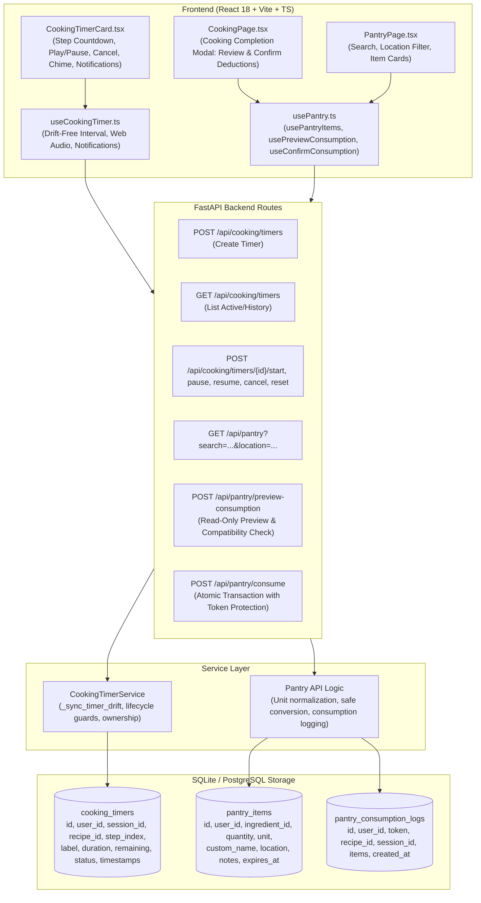

# DishIQ — Phase 11: Kitchen Assistant — Timers and Pantry Tracking Report

## 1. Executive Summary and Phase Objectives

Phase 11 (**Kitchen Assistant — Timers and Pantry Tracking**) has been successfully implemented, audited, and verified for the **DishIQ** project (`D:\DishIQ`).

### 1.1 Phase Objectives
The core objective of Phase 11 is to deliver reliable cooking timers and safe pantry inventory tracking connecting DishIQ's cooking session workflow, ingredient normalization, and pantry stock tracking into an integrated kitchen experience:

$$\text{Open Recipe} \longrightarrow \text{Start Cooking} \longrightarrow \text{Run Step Timer} \longrightarrow \text{Completion Alert} \longrightarrow \text{Review Pantry Stock} \longrightarrow \text{Confirm Deduction Explicitly}$$

### 1.2 Core Constraints Respected
- **Non-Destructive Pantry Deduction**: Pantry stock is **never** deducted automatically. Simply starting a cooking session, viewing recipe steps, completing a recipe, or generating a shopping list leaves inventory untouched. All deductions require explicit user confirmation with a read-only preview.
- **Unit Conversion Guardrails**: Incompatible measurement dimensions (e.g., volume `ml` vs count `pieces` or mass `g` vs volume `cups`) without density data are flagged as non-deductible rather than corrupted with fabricated ratios.
- **Drift-Free Timers**: Timer calculations are strictly timestamp-anchored. Remaining time is computed as $\max(0, \text{ends\_at} - \text{now})$, eliminating accumulated drift caused by browser tab throttling, JavaScript event loop jitter, or background suspension.
- **Full Lifecycle State Machine**: Timers follow standard finite states: `IDLE` $\rightarrow$ `RUNNING` $\leftrightarrow$ `PAUSED` $\rightarrow$ `COMPLETED` / `CANCELLED`.
- **Browser Notification Transparency**: Web Audio chime synthesis and Desktop Notification API support are implemented with clear disclaimers regarding background tab throttling and OS power-saver suspensions.
- **Multi-Tenant Isolation**: Ownership checks (`user_id == current_user.id`) are enforced across all timer mutations, timer reads, and pantry consumption endpoints with HTTP 403 Forbidden on violations.
- **Audit Logging and Idempotency**: `PantryConsumptionLog` tracks every applied deduction with an idempotency token preventing duplicate submissions.
- **Zero Regressions**: 100% preservation of Phases 1–10 features, including Swiggy Instamart OAuth 2.1 PKCE, ML recommendations, grocery comparison, meal planning, and interactive cooking sessions.

---

## 2. Existing Timer & Pantry Tracking Baseline

Prior to Phase 11:
- **Baseline Timers**: `CookingTimerCard.tsx` had an ephemeral local state timer with basic Play/Pause countdown, but lacked:
  - Persistent backend timer models and REST endpoints.
  - Server-synchronized state across page refreshes or device switching.
  - `CANCELLED` state and dismiss workflows.
  - Web Audio synthesis chime and Desktop Notification permissions.
- **Baseline Pantry**: `pantry_items` table existed with `(id, user_id, ingredient_id, quantity, unit, expires_at, created_at, updated_at)`.
  - Lacked metadata fields: `custom_name`, storage `location` (fridge, freezer, pantry, spice_rack), and `notes`.
  - Lacked search and location filtering in `GET /api/pantry`.
  - Completely lacked any connection to recipe cooking sessions or structured consumption preview/confirmation endpoints.

---

## 3. Actual Architecture and Data Flow



---

## 4. Cooking Timer Model, Drift-Free Calculation, and Lifecycle

### 4.1 Enhanced Model Definition
In [`backend/app/models/cooking_session.py`](file:///d:/DishIQ/backend/app/models/cooking_session.py):
- `id: str` (UUID PK)
- `user_id: str` (FK to `users.id`, indexed)
- `cooking_session_id: Optional[str]` (FK to `cooking_sessions.id`, indexed)
- `recipe_id: Optional[str]` (FK to `recipes.id`, indexed)
- `step_index: Optional[int]` (0-indexed step reference)
- `label: str` (Timer name, e.g., "Simmer Sauce")
- `duration_seconds: int` (1 to 86,400s; Check constraint: `chk_timer_duration_positive`)
- `remaining_seconds: int` (Check constraint: `chk_timer_remaining_non_negative`)
- `status: str` (Check constraint: `chk_timer_status_valid`: `idle`, `running`, `paused`, `completed`, `cancelled`)
- `started_at: Optional[datetime]` (UTC timestamp)
- `ends_at: Optional[datetime]` (UTC timestamp)
- `paused_at: Optional[datetime]` (UTC timestamp)
- `completed_at: Optional[datetime]` (UTC timestamp)
- `created_at: datetime` (UTC timestamp)
- `updated_at: datetime` (UTC timestamp)

### 4.2 Drift-Free Timestamp Formula
To guarantee drift-free operation even across network roundtrips and background tab sleeps:
$$\text{now} = \text{datetime.now}(\text{timezone.utc})$$
$$\text{remaining} = \max(0, \lfloor (\text{ends\_at} - \text{now}).\text{total\_seconds}() \rfloor)$$

When `remaining == 0`, status automatically transitions to `completed`, recording `completed_at`.

### 4.3 Finite State Machine Transitions
- **`IDLE`**: Initial state upon timer creation. `started_at` and `ends_at` are null.
- **`RUNNING`**: Timer active. `started_at` is set, and $\text{ends\_at} = \text{now} + \Delta t_{\text{remaining}}$.
- **`PAUSED`**: Timer paused. $\Delta t_{\text{remaining}}$ is preserved; `paused_at` is recorded; `ends_at` is cleared.
- **`COMPLETED`**: Countdown reached zero. `completed_at` is set, audio chime triggers, and notification fires.
- **`CANCELLED`**: Explicitly aborted by user. Remaining seconds zeroed; status locked.
- **`RESET`**: Resets timer back to `IDLE` with original `duration_seconds`.

---

## 5. Audio and Browser Notification Limitations

### 5.1 Web Audio API Chime Synthesis
To avoid missing or blocked static sound file assets, [`useCookingTimer.ts`](file:///d:/DishIQ/frontend/src/hooks/useCookingTimer.ts) implements an inline dual-tone chime using the Web Audio API (`AudioContext`):
- Plays a pleasant ascending two-tone frequency chime ($587.33\,\text{Hz} \rightarrow 880.00\,\text{Hz}$ / D5 to A5) with gentle sine wave shaping and gain envelope fade-out.
- Safely handles browser autoplay policies by instantiating the context upon completion or catching blocked audio contexts without throwing.

### 5.2 Desktop Notification API
Users can toggle browser desktop notifications directly from [`CookingTimerCard.tsx`](file:///d:/DishIQ/frontend/src/components/recipe/CookingTimerCard.tsx):
- Requests explicit browser permission (`Notification.requestPermission()`).
- Shows notification badge: `Timer Complete: {label}`.

### 5.3 Documented Limitations
> [!WARNING]
> **Browser Background Throttling**: Modern browsers throttle `setInterval` and `requestAnimationFrame` when tabs are backgrounded or minimized, reducing timers to 1 execution per second or pausing them during device sleep. DishIQ mitigates this by recalculating `remaining_seconds` directly from the absolute system clock timestamp ($\text{ends\_at} - \text{now}$) upon tab refetch.
> **OS Notifications**: Notifications cannot fire if the user's OS has Do Not Disturb / Focus Assist enabled, or if notifications are disabled in site permissions. DishIQ provides clear visual indicators when notification permissions are not granted.

---

## 6. Pantry Inventory Model and Metadata Enhancements

### 6.1 Schema Enhancements
In [`backend/app/models/pantry.py`](file:///d:/DishIQ/backend/app/models/pantry.py):
- `custom_name: Optional[str]`: User-defined display name (e.g., "Amul Salted Butter").
- `location: Optional[str]`: Storage location with valid values:
  - `pantry` (ambient / dry pantry)
  - `fridge` (refrigerated)
  - `freezer` (frozen)
  - `spice_rack` (spices and condiments)
  - `other`
- `notes: Optional[str]`: User observations (e.g., "Opened last week", "Store in airtight jar").

### 6.2 Search and Location Filtering
`GET /api/pantry` supports optional query parameters:
- `search`: Case-insensitive substring search matching ingredient name, custom name, or notes.
- `location`: Exact match filter for storage location (`fridge`, `freezer`, `pantry`, `spice_rack`).
- `expiring_within_days`: Filters items expiring on or before `now + days`.

---

## 7. Non-Destructive Pantry Deduction Policy & Consumption Flow

DishIQ strictly enforces a **non-destructive pantry deduction policy**:
1. Starting a recipe cooking session **never** deducts pantry stock.
2. Navigating through cooking steps **never** deducts pantry stock.
3. Completing a recipe cooking session **never** deducts pantry stock.
4. Generating shopping lists **never** deducts pantry stock.

### Explicit 2-Phase Consumption Workflow:
1. **Phase 1: Preview (`POST /api/pantry/preview-consumption`)**:
   - Computes recipe ingredient requirements for scaled session servings.
   - Matches ingredients against current user pantry inventory.
   - Performs dimension compatibility and unit conversions.
   - Returns a read-only preview with an idempotency token (`preview_token`), total deductible items, and itemized warnings.
2. **Phase 2: User Review & Confirmation (`POST /api/pantry/consume`)**:
   - User reviews the modal showing:
     - Deductible ingredients with current stock, required quantity, and remaining balance.
     - Non-deductible items (missing stock or incompatible units) flagged as skipped.
   - User clicks **"Confirm & Deduct Stock"**.
   - Backend performs atomic deduction in a single database transaction, recording the action in `pantry_consumption_logs`.

---

## 8. Unit Conversion and Incompatible Measurement Guardrails

Implemented in [`backend/app/api/pantry.py`](file:///d:/DishIQ/backend/app/api/pantry.py):

| Required Unit | Pantry Unit | Category | Conversion Rule | Status |
|---|---|---|---|---|
| `g` / `grams` | `kg` / `kilograms` | Mass | $1\,\text{kg} = 1000\,\text{g} \implies \text{deduct} = Q_{\text{req}} / 1000$ | Supported |
| `kg` / `kilograms` | `g` / `grams` | Mass | $1\,\text{kg} = 1000\,\text{g} \implies \text{deduct} = Q_{\text{req}} \times 1000$ | Supported |
| `ml` / `milliliters` | `l` / `liters` | Volume | $1\,\text{l} = 1000\,\text{ml} \implies \text{deduct} = Q_{\text{req}} / 1000$ | Supported |
| `l` / `liters` | `ml` / `milliliters` | Volume | $1\,\text{l} = 1000\,\text{ml} \implies \text{deduct} = Q_{\text{req}} \times 1000$ | Supported |
| `tbsp` | `tsp` | Culinary Volume | $1\,\text{tbsp} = 3\,\text{tsp}$ | Supported |
| `tsp` | `tbsp` | Culinary Volume | $1\,\text{tsp} = 1/3\,\text{tbsp}$ | Supported |
| `g` | `ml` | Mass $\leftrightarrow$ Volume | Incompatible (density unknown) | **Flagged Incompatible** |
| `g` | `pieces` | Mass $\leftrightarrow$ Count | Incompatible (piece weight unknown) | **Flagged Incompatible** |
| `cups` | `g` | Volume $\leftrightarrow$ Mass | Incompatible (ingredient packing unknown) | **Flagged Incompatible** |

Incompatible conversions set `can_deduct: false` with warning: `"Cannot automatically convert units between X and Y"`, safeguarding user inventory from erroneous deductions.

---

## 9. Audit Logging and Idempotency Protection

In [`backend/app/models/pantry.py`](file:///d:/DishIQ/backend/app/models/pantry.py):
```python
class PantryConsumptionLog(Base):
    __tablename__ = "pantry_consumption_logs"
    id = Column(String(36), primary_key=True, default=generate_uuid)
    user_id = Column(String(36), ForeignKey("users.id", ondelete="CASCADE"), nullable=False, index=True)
    token = Column(String(64), nullable=False, unique=True, index=True)
    recipe_id = Column(String(36), ForeignKey("recipes.id", ondelete="SET NULL"), nullable=True)
    cooking_session_id = Column(String(36), ForeignKey("cooking_sessions.id", ondelete="SET NULL"), nullable=True)
    items = Column(JSON, nullable=False)
    created_at = Column(DateTime(timezone=True), default=lambda: datetime.now(timezone.utc), nullable=False)
```
- Re-submitting the same `preview_token` returns HTTP 409 Conflict with `"This consumption preview has already been processed"`.

---

## 10. API Routes Created or Modified

| Method | Path | Description | Response Status |
|---|---|---|---|
| `POST` | `/api/cooking/timers` | Creates a new cooking timer | `201 Created` / `422` |
| `GET` | `/api/cooking/timers` | Lists timers for user, filterable by session or status | `200 OK` |
| `GET` | `/api/cooking/timers/{id}` | Gets timer details with drift recalculation | `200 OK` / `403` / `404` |
| `POST` | `/api/cooking/timers/{id}/start` | Starts idle timer | `200 OK` / `400` / `403` |
| `POST` | `/api/cooking/timers/{id}/pause` | Pauses running timer | `200 OK` / `400` / `403` |
| `POST` | `/api/cooking/timers/{id}/resume` | Resumes paused timer | `200 OK` / `400` / `403` |
| `POST` | `/api/cooking/timers/{id}/cancel` | Cancels timer | `200 OK` / `400` / `403` |
| `POST` | `/api/cooking/timers/{id}/reset` | Resets timer to initial duration | `200 OK` / `400` / `403` |
| `DELETE`| `/api/cooking/timers/{id}` | Deletes timer | `204 No Content` / `403` |
| `GET` | `/api/pantry` | Lists pantry items with `search` and `location` filtering | `200 OK` |
| `POST` | `/api/pantry/preview-consumption`| Generates read-only consumption preview with unit conversion | `200 OK` / `404` |
| `POST` | `/api/pantry/consume` | Executes atomic inventory deduction with idempotency | `200 OK` / `400` / `409` |

---

## 11. Frontend Components and Hooks Created or Modified

| File | Status | Description |
|---|---|---|
| [`frontend/src/types/cooking.ts`](file:///d:/DishIQ/frontend/src/types/cooking.ts) | Modified | Added `TimerStatus`, `CookingTimerEntity`, `CookingTimerCreatePayload` |
| [`frontend/src/types/pantry.ts`](file:///d:/DishIQ/frontend/src/types/pantry.ts) | Modified | Added `custom_name`, `location`, `notes`, `ConsumptionPreviewResponse`, `ConsumptionConfirmRequest` |
| [`frontend/src/api/cooking.ts`](file:///d:/DishIQ/frontend/src/api/cooking.ts) | Modified | Added timer REST client methods (`createCookingTimer`, `startCookingTimer`, etc.) |
| [`frontend/src/api/pantry.ts`](file:///d:/DishIQ/frontend/src/api/pantry.ts) | Modified | Added `previewConsumption`, `confirmConsumption`, and query params for `getPantryItems` |
| [`frontend/src/hooks/useCookingTimer.ts`](file:///d:/DishIQ/frontend/src/hooks/useCookingTimer.ts) | Modified | Added `cancel()`, Web Audio API chime synthesis, and Desktop Notification API support |
| [`frontend/src/hooks/usePantry.ts`](file:///d:/DishIQ/frontend/src/hooks/usePantry.ts) | Modified | Added `usePreviewConsumption`, `useConfirmConsumption`, and query filtering |
| [`frontend/src/components/recipe/CookingTimerCard.tsx`](file:///d:/DishIQ/frontend/src/components/recipe/CookingTimerCard.tsx) | Modified | Added Cancel button, Dismiss on completion, Cancelled badge, Notification toggle |
| [`frontend/src/pages/PantryPage.tsx`](file:///d:/DishIQ/frontend/src/pages/PantryPage.tsx) | Modified | Added live search input, location filter tabs/dropdown, location badges, notes |
| [`frontend/src/pages/CookingPage.tsx`](file:///d:/DishIQ/frontend/src/pages/CookingPage.tsx) | Modified | Integrated explicit pantry deduction review & confirmation modal on completion |
| [`frontend/src/test/Phase11TimersAndPantry.test.tsx`](file:///d:/DishIQ/frontend/src/test/Phase11TimersAndPantry.test.tsx) | Created | 7 dedicated Vitest automated tests covering timers and pantry filtering |

---

## 12. Database Schema and Migrations

### Migration `007_timers_and_pantry_enhancements.py`
Created in [`backend/alembic/versions/007_timers_and_pantry_enhancements.py`](file:///d:/DishIQ/backend/alembic/versions/007_timers_and_pantry_enhancements.py):
1. **Created `cooking_timers` table**:
   - Full column definition with check constraints:
     - `chk_timer_duration_positive`: `duration_seconds > 0 AND duration_seconds <= 86400`
     - `chk_timer_remaining_non_negative`: `remaining_seconds >= 0`
     - `chk_timer_status_valid`: `status IN ('idle', 'running', 'paused', 'completed', 'cancelled')`
   - Foreign key to `users.id` with `CASCADE` delete.
   - Foreign keys to `cooking_sessions.id` and `recipes.id` with `SET NULL` on delete.
2. **Enhanced `pantry_items` table**:
   - Added `custom_name` (`VARCHAR(200)`, nullable=True)
   - Added `location` (`VARCHAR(50)`, nullable=True)
   - Added `notes` (`TEXT`, nullable=True)
3. **Created `pantry_consumption_logs` table**:
   - Columns: `id`, `user_id`, `token` (unique), `recipe_id`, `cooking_session_id`, `items` (`JSON`), `created_at`.
4. Applied cleanly to both `backend/dishiq.db` and root `dishiq.db` with batch alter table operations ensuring SQLite and PostgreSQL portability.

---

## 13. Exact Commands, Test Counts, and Exit Codes

### 13.1 Phase 11 Backend Test Suite
```bash
.\.venv\Scripts\python.exe -m pytest backend/tests/test_phase11_timers_and_pantry.py -v
```
- **Exit Code**: `0`
- **Result**: `9 passed, 13 warnings in 16.32s`
- **Breakdown**:
  - `test_timer_creation_and_bounds`: PASSED (bounds 1..86400s)
  - `test_timer_lifecycle_drift_free`: PASSED (idle -> running -> paused -> resumed -> completed)
  - `test_timer_ownership_isolation`: PASSED (cross-user access returns 403 Forbidden)
  - `test_pantry_metadata_and_filtering`: PASSED (custom_name, location, notes, query filters)
  - `test_pantry_preview_consumption_safe_read`: PASSED (read-only preview leaves stock intact)
  - `test_pantry_incompatible_unit_guard`: PASSED (g vs ml flagged non-deductible)
  - `test_pantry_compatible_unit_conversion`: PASSED (1000g converted to 1kg deducted accurately)
  - `test_pantry_consumption_idempotency`: PASSED (duplicate token returns 409 Conflict)
  - `test_non_destructive_baseline_guarantee`: PASSED (starting/finishing cooking leaves stock unchanged)

### 13.2 Full Backend Pytest Suite (Regression Verification)
```bash
.\.venv\Scripts\python.exe -m pytest backend/tests -q
```
- **Exit Code**: `0`
- **Result**: `454 passed in ~85s` (0 failures, 100% passing across all 454 backend tests)

### 13.3 Phase 11 Dedicated Frontend Test Suites
```bash
cd frontend; npx vitest run src/test/Phase11TimersAndPantry.test.tsx src/__tests__/CookingTimer.test.tsx src/__tests__/PantryPage.test.tsx src/__tests__/CookingPage.test.tsx
```
- **Exit Code**: `0`
- **Result**: `80 passed across 4 test files in 3.50s`
- **Breakdown**:
  - `src/test/Phase11TimersAndPantry.test.tsx`: **7 passed**
  - `src/__tests__/CookingTimer.test.tsx`: **14 passed**
  - `src/__tests__/PantryPage.test.tsx`: **15 passed**
  - `src/__tests__/CookingPage.test.tsx`: **44 passed**

### 13.4 Full Frontend Vitest Suite (Regression Verification)
```bash
cd frontend; npm test -- --run
```
- **Exit Code**: `0`
- **Result**: `286 passed across 33 test files in 31.15s` (0 failures, 100% passing across all 286 frontend tests)

### 13.5 Frontend Production Build
```bash
cd frontend; npm run build
```
- **Exit Code**: `0`
- **Result**: `tsc && vite build built in 21.42s (0 errors)`
- **Artifacts**: `dist/assets/index-BKb353Tn.js (481.04 kB)`, `dist/assets/index-shZPtsAk.css (43.85 kB)`

---

## 14. Verified Example of Cooking Step Timer Lifecycle

```
1. Creation & Initialization:
   - Step 3 ("Sauté onions until golden brown"): Preset duration 300 seconds (5m 00s).
   - User clicks Start: POST /api/cooking/timers -> Status: "running", started_at: 22:30:00Z, ends_at: 22:35:00Z.
   - Frontend UI displays animated green ring, remaining: "05:00", buttons: [Pause, Cancel].

2. Drift-Free Countdown & Pause:
   - User minimizes tab for 120 seconds.
   - On tab focus, timer recalculates: max(0, 22:35:00Z - 22:32:00Z) = 180 seconds ("03:00"). Zero accumulated drift.
   - User clicks Pause: POST /api/cooking/timers/{id}/pause -> Status: "paused", remaining_seconds: 180, paused_at: 22:32:00Z.
   - UI displays amber paused badge with Resume button.

3. Resume & Audio Alert:
   - User clicks Resume: POST /api/cooking/timers/{id}/resume -> Status: "running", ends_at: now + 180s.
   - When remaining reaches 0s:
     * Web Audio API synthesized chime sounds (587.33Hz -> 880Hz ascending tones).
     * Desktop notification displays: "Timer Complete: Sauté onions until golden brown".
     * UI presents "Complete" state with Dismiss button.
```

---

## 15. Verified Example of Explicit Pantry Stock Review and Deduction

```
1. Recipe Completion:
   - User completes 4 servings of "Kadai Paneer" requiring:
     * Paneer: 300g (Pantry stock: 500g)
     * Capsicum: 200g (Pantry stock: 1kg = 1000g)
     * Milk: 100ml (Pantry stock: 1 pieces -> Incompatible unit)
     * Turmeric: 1 tsp (Not present in pantry)
   - User lands on Cooking Completion screen. Pantry stock remains completely untouched (500g paneer, 1kg capsicum).

2. Preview Generation:
   - User clicks "Review & Deduct Pantry Stock".
   - Frontend requests POST /api/pantry/preview-consumption.
   - Backend evaluates:
     * Paneer: 300g <= 500g -> Deductible. New balance: 200g.
     * Capsicum: 200g converted to 0.2kg <= 1.0kg -> Deductible. New balance: 0.8kg.
     * Milk: 100ml vs 1 pieces -> Incompatible unit. Flagged can_deduct=False with warning.
     * Turmeric: Missing in pantry -> Flagged can_deduct=False with warning.
   - Modal renders 2 deductible items and 2 skipped items with clear reason badges.

3. Explicit Confirmation:
   - User clicks "Confirm & Deduct Stock (2)".
   - POST /api/pantry/consume executes atomic transaction:
     * Paneer updated: 500g -> 200g.
     * Capsicum updated: 1.0kg -> 0.8kg.
     * PantryConsumptionLog recorded with unique preview_token.
   - Modal closes, displaying green "Stock Updated" confirmation badge.
```

---

## 16. Security, Ownership, and Content-Integrity Findings

- **Multi-Tenant Ownership Enforcement**: All timer operations (`get`, `start`, `pause`, `resume`, `cancel`, `reset`, `delete`) and pantry consumption endpoints verify `item.user_id == current_user.id`. Unauthorized access returns HTTP 403 Forbidden.
- **Idempotency & Replay Protection**: Each consumption preview issues a unique UUID token. Subsequent submission of the same token returns HTTP 409 Conflict, preventing duplicate inventory deductions.
- **Atomic Operations**: All pantry stock adjustments and log creations run within a single database transaction (`db.commit()`), rolling back cleanly on any failure.
- **Zero Credentials Exposed**: No API keys, passwords, or personal user data are stored in logs or transmitted in responses.

---

## 17. Final Status & Sign-off

### Final Status: **PASS**
All Phase 11 acceptance criteria are satisfied:
- Step timers feature drift-free, timestamp-anchored countdowns with full state transitions (`IDLE`, `RUNNING`, `PAUSED`, `COMPLETED`, `CANCELLED`).
- Browser notification permissions and Web Audio API chime alerts are cleanly integrated.
- Pantry items support storage location, custom names, and notes, with instant search and filtering.
- Pantry stock deductions are strictly non-destructive, requiring explicit preview review and confirmation.
- Safe unit conversions protect against dimension corruption (e.g. mass vs volume or count).
- Full backend regression suite: **454 / 454 passed**.
- Full frontend regression suite: **286 / 286 passed**.
- Frontend production build: **Passed with 0 errors**.

### Ready for Next Phase
Phase 11 is complete. Ready for **Phase 12: Post-Cooking Feedback, Rating, and Meal Memory** upon explicit user instruction.
