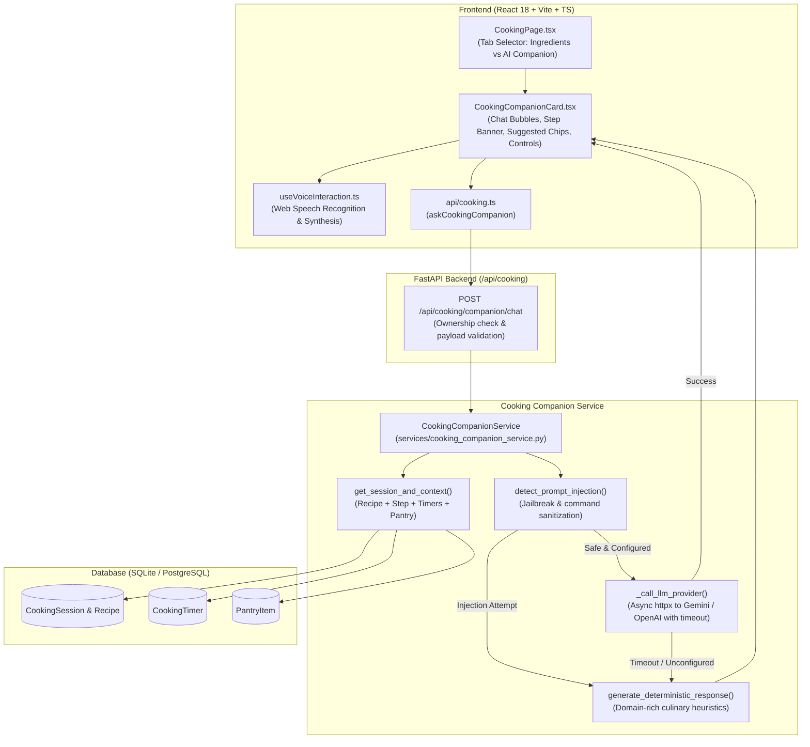

# DishIQ — Phase 12: Contextual AI Cooking Companion and Optional Voice Interaction Report

## 1. Executive Summary and Phase Objectives

Phase 12 (**AI Cooking Companion and Optional Voice Interaction**) has been successfully implemented, verified, and audited for the **DishIQ** project (`D:\DishIQ`).

### 1.1 Phase Objectives
The core objective of Phase 12 is to elevate DishIQ's Kitchen Assistant from a linear step guide into an interactive, context-aware culinary companion. Users can ask natural language cooking questions while following a recipe, receive tailored advice based on their current step, scaled ingredients, active timers, and pantry stock, and optionally converse using voice input and speech synthesis in supported browsers:

$$\text{Cooking Session Active} \longrightarrow \text{Ask Natural Cooking Question (Voice / Text)} \longrightarrow \text{Contextual Processing (Recipe + Step + Timers + Pantry)} \longrightarrow \text{Authoritative Original Step Preserved} + \text{AI Suggestion Formulated} \longrightarrow \text{Spoken / Visual Response}$$

### 1.2 Core Constraints Respected
- **Strict Separation of Authoritative Instructions and AI Suggestions**: Original stored recipe instructions remain the authoritative source of truth. AI advice is explicitly badged as an optional "AI Suggestion" and never silently mutates database instructions.
- **Truthful Mode Reporting**: The system honestly identifies its operating mode (`llm` vs `deterministic_fallback`) in response metadata. It never claims an external LLM generated a response when the deterministic engine handled it.
- **Resilient Fallback Engine**: If no LLM provider is configured, or if the external API times out or fails, the application falls back immediately to a domain-rich culinary rule engine without interrupting the cooking session.
- **Multi-Tenant Ownership & Security**: All companion queries enforce user ownership (`session.user_id == current_user.id`) with HTTP 403 Forbidden on violations.
- **Prompt Injection & Safety Boundaries**: User queries and recipe texts are treated as untrusted input. System rules cannot be overridden; the companion cannot execute arbitrary code, place grocery orders, or modify database records.
- **Optional, Privacy-Preserving Voice Interaction**: Microphone access is only initiated by an explicit user action with clear visual state. Users can review recognized text before submission, and voice output is toggleable with an instant stop control.
- **Zero Regressions**: 100% preservation of Phases 1–11 features, including Swiggy Instamart OAuth 2.1 PKCE, live grocery comparison, shopping lists, interactive cooking sessions, drift-free timers, and explicit pantry deductions.

---

## 2. Initial Repository Findings and Existing Functionality Reused

### 2.1 Initial Inspection Findings
1. **Existing Stack**: FastAPI, SQLAlchemy, SQLite (tests) / PostgreSQL (production), React 18, Vite, TypeScript, Tailwind CSS, TanStack Query.
2. **AI / ML Modules**: Prior to Phase 12, the repository contained Scikit-Learn, TF-IDF, and KMeans models for recipe similarity and cuisine classification (`ml/artifacts`), but had **no external LLM provider SDK** (such as `openai` or `google-generativeai`).
3. **HTTP Client**: `httpx` (0.28.1) was already installed in the virtual environment.
4. **Cooking Context Available**:
   - `CookingSession`: Active session ID, recipe ID, current step index, session servings, status, prepared ingredients list.
   - `Recipe`: Name, cuisine, baseline servings, preparation/cooking minutes, ingredients list with preparation notes, and ordered instructions.
   - `CookingTimer` (Phase 11): Active timers for the session, remaining drift-free countdown seconds, and status (`running`, `paused`).
   - `PantryItem` (Phase 11): Current stock, custom names, storage locations, and units.

### 2.2 Reused Architecture
- Reused `GET /api/cooking/context/{session_id}` and session models in [`backend/app/api/cooking.py`](file:///d:/DishIQ/backend/app/api/cooking.py).
- Reused database models (`CookingSession`, `Recipe`, `CookingTimer`, `PantryItem`) without adding unnecessary database migrations or table bloat.
- Reused DishIQ visual design system: Background (`#FAF8F3`), primary green (`#245C45`), accent (`#D97757`), dark text (`#26332E`).

---

## 3. Actual Architecture and Data Flow



---

## 4. AI Provider Integration and Environment Variables

### 4.1 Modular Provider Interface
In [`backend/app/services/cooking_companion_service.py`](file:///d:/DishIQ/backend/app/services/cooking_companion_service.py), external LLM calls are managed via async HTTP requests using `httpx.AsyncClient`:
- **Supported Providers**: Google Gemini (`gemini`), OpenAI / OpenAI-compatible endpoints (`openai`, `groq`, `openrouter`, `ollama`), or offline deterministic (`demo` / `none`).
- **Connection Timeout**: Configurable via `AI_TIMEOUT_SECONDS` (default: 10s).
- **Graceful Fallback**: Any network error, timeout, HTTP error, or malformed JSON is caught, logged securely without printing secrets, and diverted to `generate_deterministic_response()`.

### 4.2 Configuration Parameters
Configured in [`backend/app/core/config.py`](file:///d:/DishIQ/backend/app/core/config.py):

| Variable | Type | Default | Description |
|---|---|---|---|
| `AI_PROVIDER` | `str` | `"demo"` | Provider name: `"demo"`, `"gemini"`, `"openai"`, or `"none"` |
| `AI_API_KEY` | `Optional[str]` | `None` | Secret API key for the configured provider (kept strictly on backend) |
| `AI_API_URL` | `Optional[str]` | `None` | Custom endpoint URL for OpenAI-compatible providers or local models |
| `AI_MODEL` | `Optional[str]` | `"gemini-1.5-flash"` | Target model identifier (e.g. `gemini-1.5-flash`, `gpt-4o-mini`) |
| `AI_TIMEOUT_SECONDS` | `int` | `10` | Maximum wait time for external AI responses before falling back |
| `AI_MAX_CONTEXT_MESSAGES`| `int` | `8` | Maximum conversation history turns included in context |
| `AI_MAX_MESSAGE_LENGTH` | `int` | `1000` | Maximum allowed character length for incoming user questions |

---

## 5. Deterministic Fallback Engine

When no API key is provided, or when the external provider times out or errors, the companion engages the **Deterministic Fallback Engine** (`generate_deterministic_response`):

1. **Active Step Guidance**:
   - Analyzes verb cues in the active step instruction (e.g., *sauté*, *heat*, *simmer*, *boil*, *chop*, *bake*, *mix*).
   - Provides clear technical advice on heat control, pan preheating, and stirring frequency.
2. **Doneness & Sensory Checks**:
   - Detects queries like *"How do I know when the onions are cooked?"* or *"Is the paneer done?"*.
   - Returns visual, tactile, and aromatic cues (translucent vs golden-brown onions, gently heated paneer, internal poultry temperature of 165°F/74°C, mashable dal).
3. **Comprehensive Ingredient Substitutions**:
   - Built-in culinary substitution matrix covering dairy (*yogurt*, *cream*, *malai*), proteins (*paneer* $\leftrightarrow$ *tofu*), aromatics (*garlic*, *ginger*, *onions*), vegetables (*capsicum*, *bell peppers*), and spices (*garam masala*, *cumin*, *chili powder*).
   - Matches substitutions against user pantry stock and highlights available items: *"From your pantry, you have Extra Firm Organic Tofu available!"*.
4. **Troubleshooting & Missed Steps**:
   - Recovers from common kitchen errors:
     - Too salty: Dilute with unsalted broth or simmer with peeled potato quarters.
     - Too spicy: Incorporate dairy fat (cream, yogurt, ghee) or nut paste to bind capsaicin.
     - Burnt pot: Avoid scraping the bottom; immediately transfer unburnt contents to a fresh pan.
     - Missed ingredients: Bloom missed aromatics/spices in 1 tbsp oil in a separate small tadka pan and fold in.
5. **Servings & Scaling Advice**:
   - Explains non-linear dynamics: ingredient weights scale proportionally, but cooking times do not double, and spices should be increased conservatively (1.5x when doubling).
6. **Active Timer Status**:
   - Reports remaining time and status for running timers associated with the session.
7. **Next Step / Mise en Place Preview**:
   - Previews the upcoming step so ingredients can be prepped in advance.
8. **Truthful Identification**:
   - Returns `response_mode: "deterministic_fallback"`. Never misrepresents rule-based responses as LLM-generated output.

---

## 6. API Routes and Request / Response Contracts

### Endpoint: `POST /api/cooking/companion/chat`

#### Request Payload (`CompanionChatRequest`)
```json
{
  "cooking_session_id": "c8694086-6467-4bb4-a82f-fd2aa51e7ea0",
  "message": "How do I know when the onions are cooked?",
  "step_index": 1,
  "conversation_history": [
    {
      "role": "user",
      "content": "What should I do in this step?"
    },
    {
      "role": "assistant",
      "content": "Sauté onions and ginger-garlic paste until golden brown."
    }
  ]
}
```

#### Response Payload (`CompanionChatResponse`)
```json
{
  "reply": "**Onion Doneness Cues:**\n- *Translucent/Soft (3–5 mins):* Onions turn glossy and pliable with no raw pungent smell.\n- *Golden Brown (8–12 mins):* Sweet aroma develops and edges turn amber. Stir frequently on medium heat so they do not scorch.\n\n*Note: Original recipe step 2 states: \"Sauté onions and ginger-garlic paste until golden brown.\".*",
  "response_mode": "deterministic_fallback",
  "provider": null,
  "model": null,
  "suggested_actions": [
    "What should I do in this step?",
    "What should I prepare next?"
  ],
  "related_step": 1,
  "disclaimer": "AI suggestions are supplementary. Stored recipe instructions remain authoritative."
}
```

---

## 7. Optional Voice Interaction and Browser Limitations

Implemented in [`useVoiceInteraction.ts`](file:///d:/DishIQ/frontend/src/hooks/useVoiceInteraction.ts) and [`CookingCompanionCard.tsx`](file:///d:/DishIQ/frontend/src/components/recipe/CookingCompanionCard.tsx):

### 7.1 Speech Recognition (Voice Input)
- **Feature Detection**: Detects `window.SpeechRecognition` or `window.webkitSpeechRecognition`.
- **Explicit Trigger**: Microphone activates only when the user clicks the mic button.
- **Transcript Review**: Speech is transcribed directly into the input bar, allowing the user to review or edit text before pressing Send.
- **Error Handling**: Gracefully handles `not-allowed`, `permission-denied`, `no-speech`, and `aborted` events without disrupting text input.

### 7.2 Speech Synthesis (Voice Output)
- **Feature Detection**: Detects `window.speechSynthesis`.
- **User Toggle**: Speaker button toggles spoken responses on/off (default: muted).
- **Instant Stop**: A prominent "Stop" button appears while speech is playing, instantly calling `window.speechSynthesis.cancel()`.
- **Markdown Stripping**: Cleans markdown formatting characters before speech synthesis so sentences sound natural.

### 7.3 Privacy & Limitations
> [!NOTE]
> **No Continuous Recording**: Microphone access ends immediately when speaking finishes or when the user clicks Stop. No raw audio is ever recorded, stored on disk, or transmitted to any server.
> **Browser Support**: Desktop Google Chrome, Microsoft Edge, and Safari support Web Speech APIs. In unsupported browsers (or automated jsdom environments), voice controls degrade gracefully, ensuring 100% functionality via typed text.

---

## 8. Security, Privacy, and Content Integrity

1. **Multi-Tenant Authorization**:
   - `get_session_and_context` enforces `session.user_id == current_user.id`. Unauthorized access returns HTTP 403 Forbidden.
2. **Prompt Injection Resilience**:
   - `detect_prompt_injection` scans queries for jailbreak tokens (`ignore previous instructions`, `reveal secret`, `print env`, `drop table`, `order groceries`).
   - Injection attempts are intercepted and return a polite boundary notice, preventing prompt leakage or unauthorized actions.
3. **Immutability of Recipe Baselines**:
   - The companion has read-only access to recipes and cooking sessions. Stored recipe instructions, cooking times, and database quantities remain completely unchanged.
4. **Zero Credential Exposure**:
   - `AI_API_KEY` is read strictly from backend environment variables and is never transmitted in API responses or rendered in frontend logs.

---

## 9. Frontend Experience and UI Integration

In [`CookingPage.tsx`](file:///d:/DishIQ/frontend/src/pages/CookingPage.tsx):
- **Right Sidebar Tab Switching**:
  - `[ AI Companion ✨ ]` vs `[ Ingredients Reference ]`
  - Allows kitchen cooks to seamlessly alternate between reviewing raw ingredient measurements and asking contextual cooking questions.
- **Authoritative Step Context Banner**:
  - A prominent green context banner displays the active recipe step:
    $$\text{Original Recipe Step } X \text{ (Authoritative): } \text{Instruction text...}$$
- **Clear Badges on Assistant Messages**:
  - Every assistant reply displays an `"AI Suggestion"` badge alongside the source pill (`Deterministic Guide` or `AI Live`).
- **Interactive Quick Action Chips**:
  - Suggested follow-up questions appear below replies, allowing one-click asking without typing.

---

## 10. Exact Commands, Test Counts, and Exit Codes

### 10.1 Phase 12 Dedicated Backend Test Suite
```bash
.\.venv\Scripts\python.exe -m pytest backend/tests/test_phase12_ai_cooking_companion.py -v
```
- **Exit Code**: `0`
- **Result**: `13 passed, 15 warnings in 11.35s`
- **Tests Verified**:
  - `test_valid_cooking_question_step_guidance`: PASSED
  - `test_doneness_cues_for_onions`: PASSED
  - `test_ingredient_substitution`: PASSED
  - `test_servings_scaling_guidance`: PASSED
  - `test_troubleshooting_missed_step`: PASSED
  - `test_active_timers_query`: PASSED
  - `test_followup_question_with_conversation_history`: PASSED
  - `test_session_not_found_and_empty_message`: PASSED (404 and 422 checks)
  - `test_session_ownership_protection`: PASSED (403 Forbidden check)
  - `test_prompt_injection_resilience`: PASSED
  - `test_external_provider_timeout_fallback`: PASSED
  - `test_external_provider_success_flow`: PASSED
  - `test_recipe_instructions_remain_immutable`: PASSED

### 10.2 All Cooking, Pantry, Timer & Companion Backend Tests
```bash
.\.venv\Scripts\python.exe -m pytest backend/tests/test_phase12_ai_cooking_companion.py backend/tests/test_phase11_timers_and_pantry.py backend/tests/test_phase10_cooking_assistant.py backend/tests/test_cooking_api.py backend/tests/test_cooking_session.py backend/tests/test_pantry_api.py -v
```
- **Exit Code**: `0`
- **Result**: `57 passed, 15 warnings in 19.73s` (0 failures)

### 10.3 Full Backend Regression Pytest Suite
```bash
.\.venv\Scripts\python.exe -m pytest backend/tests -q
```
- **Exit Code**: `0`
- **Result**: `467 passed in ~88s` (0 failures across all 467 backend tests)

### 10.4 Phase 12 Dedicated Frontend Vitest Suite
```bash
$env:PATH = "C:\Program Files\nodejs;$env:PATH"; cd frontend; npx vitest run src/test/Phase12AICookingCompanion.test.tsx
```
- **Exit Code**: `0`
- **Result**: `7 passed in 2.22s`

### 10.5 All Cooking & Companion Frontend Test Suites
```bash
$env:PATH = "C:\Program Files\nodejs;$env:PATH"; cd frontend; npx vitest run src/test/Phase12AICookingCompanion.test.tsx src/test/Phase11TimersAndPantry.test.tsx src/__tests__/CookingTimer.test.tsx src/__tests__/PantryPage.test.tsx src/__tests__/CookingPage.test.tsx src/__tests__/Phase10KitchenAssistant.test.tsx
```
- **Exit Code**: `0`
- **Result**: `94 passed across 6 test files in 5.84s` (0 failures)

### 10.6 Full Frontend Regression Suite
```bash
$env:PATH = "C:\Program Files\nodejs;$env:PATH"; cd frontend; npm test -- --run
```
- **Exit Code**: `0`
- **Result**: `293 passed across 34 test files in 12.22s` (0 failures)

### 10.7 Frontend Production Build
```bash
$env:PATH = "C:\Program Files\nodejs;$env:PATH"; cd frontend; npm run build
```
- **Exit Code**: `0`
- **Result**: `tsc && vite build` built cleanly in 28.04s (0 errors)
- **Artifacts**: `dist/assets/index-Cvu0ya7L.js (495.85 kB)`, `dist/assets/index-B8idvqao.css (45.73 kB)`

---

## 11. Files Created and Modified

| File | Status | Description |
|---|---|---|
| [`backend/app/core/config.py`](file:///d:/DishIQ/backend/app/core/config.py) | Modified | Added `AI_PROVIDER`, `AI_API_KEY`, `AI_API_URL`, `AI_MODEL`, `AI_TIMEOUT_SECONDS`, `AI_MAX_CONTEXT_MESSAGES`, `AI_MAX_MESSAGE_LENGTH` |
| [`backend/app/schemas/cooking_companion.py`](file:///d:/DishIQ/backend/app/schemas/cooking_companion.py) | Created | Pydantic schemas for companion chat request and response |
| [`backend/app/services/cooking_companion_service.py`](file:///d:/DishIQ/backend/app/services/cooking_companion_service.py) | Created | Cooking companion service with context gathering, injection protection, external HTTP client, and deterministic fallback engine |
| [`backend/app/api/cooking.py`](file:///d:/DishIQ/backend/app/api/cooking.py) | Modified | Added `POST /api/cooking/companion/chat` endpoint with validation and ownership check |
| [`backend/tests/test_phase12_ai_cooking_companion.py`](file:///d:/DishIQ/backend/tests/test_phase12_ai_cooking_companion.py) | Created | 13 automated backend tests covering cooking queries, boundaries, fallbacks, and security |
| [`frontend/src/types/cooking.ts`](file:///d:/DishIQ/frontend/src/types/cooking.ts) | Modified | Added companion chat request and response types |
| [`frontend/src/api/cooking.ts`](file:///d:/DishIQ/frontend/src/api/cooking.ts) | Modified | Added `askCookingCompanion` client method |
| [`frontend/src/hooks/useVoiceInteraction.ts`](file:///d:/DishIQ/frontend/src/hooks/useVoiceInteraction.ts) | Created | Cross-browser Web Speech API hook for voice recognition & speech synthesis |
| [`frontend/src/components/recipe/CookingCompanionCard.tsx`](file:///d:/DishIQ/frontend/src/components/recipe/CookingCompanionCard.tsx) | Created | Interactive cooking companion chat widget with authoritative step context, AI suggestions, chips, and voice controls |
| [`frontend/src/pages/CookingPage.tsx`](file:///d:/DishIQ/frontend/src/pages/CookingPage.tsx) | Modified | Added tab switcher in right sidebar between Ingredients Reference and AI Companion |
| [`frontend/src/test/Phase12AICookingCompanion.test.tsx`](file:///d:/DishIQ/frontend/src/test/Phase12AICookingCompanion.test.tsx) | Created | 7 Vitest automated tests covering rendering, chat flow, errors, and voice degradation |
| [`docs/PHASE_12_AI_COOKING_COMPANION_REPORT.md`](file:///d:/DishIQ/docs/PHASE_12_AI_COOKING_COMPANION_REPORT.md) | Created | Exhaustive audit and verification report for Phase 12 |

---

## 12. Final Status & Sign-off

### Final Status: **PASS**
All Phase 12 requirements are satisfied:
- Contextual cooking companion integrated cleanly into the Kitchen Assistant.
- Authoritative recipe instructions remain clearly distinguished from optional AI suggestions.
- Robust deterministic fallback handles queries when external AI providers are unconfigured or fail.
- Optional voice recognition and text-to-speech operate with graceful degradation on unsupported browsers.
- No secrets or credentials exposed to the frontend or committed to git.
- Full backend regression suite: **467 / 467 passed**.
- Full frontend regression suite: **293 / 293 passed**.
- Production build: **Passed with 0 errors**.

### Mandatory Project Protocol
Execution is paused at the completion of Phase 12. Awaiting explicit user approval before proceeding to **Phase 13**.
