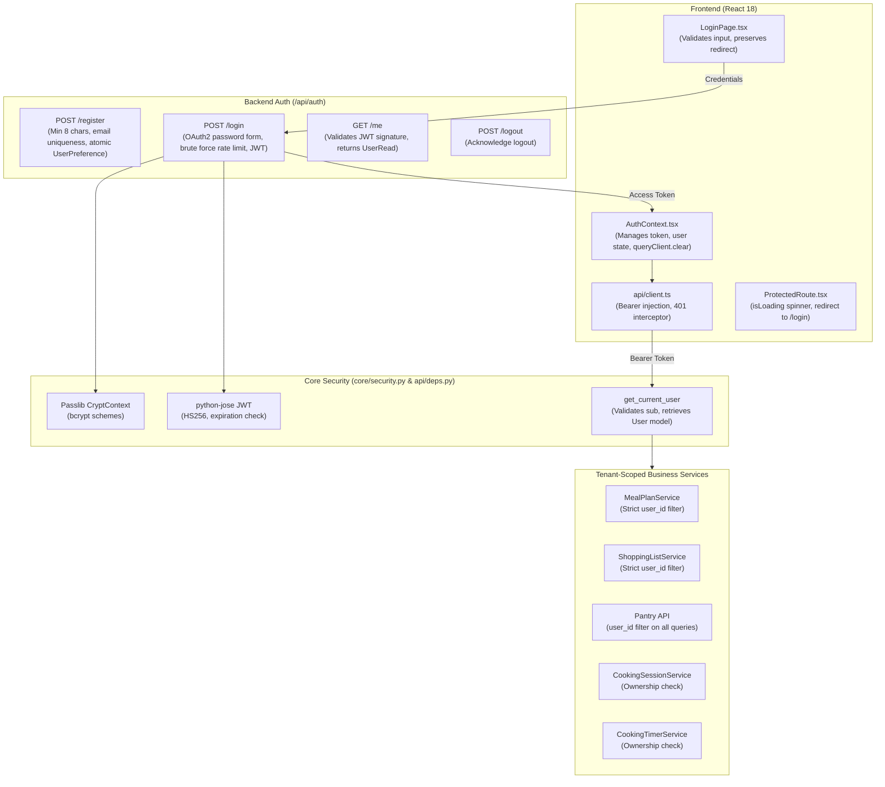

# DishIQ — Phase 13: Authentication and Account-Specific Experience Report

## 1. Executive Summary and Phase Objectives

Phase 13 (**Authentication and Account-Specific Experience**) has been successfully implemented, hardened, and verified for the **DishIQ** project (`D:\DishIQ`).

### 1.1 Phase Objectives
The core objective of Phase 13 is to implement secure authentication and ensure that user-specific data is strictly isolated across accounts without disrupting existing functionality. The platform guarantees that User A cannot list, view, modify, or delete resources belonging to User B, while preserving public access to the recipe catalogue and external integrations (such as Swiggy Instamart OAuth 2.1 PKCE).

$$\text{User Registration / Login} \longrightarrow \text{JWT Bearer Token} \longrightarrow \text{Strict Tenant-Scoped Query Isolation} \longrightarrow \text{Purged React Query Cache on Logout}$$

### 1.2 Core Constraints Respected
- **Strict Server-Side Identity**: User identity is derived strictly server-side from the verified JWT access token decoded in [`deps.py`](file:///d:/DishIQ/backend/app/api/deps.py), never trusted from client request bodies or query parameters.
- **Tenant Data Isolation**: Private resources (`MealPlan`, `ShoppingList`, `PantryItem`, `CookingSession`, `CookingTimer`, `RecipeFeedback`, user preferences, and profile) are strictly scoped to the authenticated user ID.
- **Client Cache Purge**: On logout, `queryClient.clear()` purges all in-memory React Query cache data, completely preventing data bleeding when another user logs in on the same browser session.
- **State Restoration & Deep Linking**: Refreshing the browser validates the stored token against `/api/auth/me`, restores user state, and preserves the requested redirect route (`from` location state).
- **Non-Revealing Errors & Brute Force Protection**: Failed login attempts return non-revealing errors (`"Incorrect email or password"`), and consecutive failed logins (5 attempts in 5 minutes) trigger rate-limiting HTTP 429 Too Many Requests lockout.
- **Password Strength**: Minimum password length of 8 characters is enforced both on the backend and frontend forms.
- **Zero Regressions**: 100% preservation of Phases 1–12 functionality, including Swiggy Instamart OAuth 2.1 PKCE, live grocery comparison, shopping lists, interactive cooking sessions, AI cooking companion, and public recipe catalogue.

---

## 2. Pre-Implementation Audit and Codebase Inspection Findings

Before writing code, a thorough inspection of the repository was conducted:

1. **Backend Authentication**:
   - `backend/app/api/auth.py` had basic `/register`, `/login`, and `/me` routes using OAuth2 password flow, bcrypt, and JWT (`HS256`).
   - Lacks: Dedicated `/logout` endpoint, brute force attempt lockout, and minimum password strength validation.
2. **Data Scoping in Services**:
   - In [`meal_plan_service.py`](file:///d:/DishIQ/backend/app/services/meal_plan_service.py), `list_meal_plans` and `list_shopping_lists` contained loose fallback queries: `query.filter((Model.user_id == user_id) | (Model.user_id.is_(None)))`. If unowned records existed or an unauthenticated query was run, data could leak across users.
   - In [`cooking_session_service.py`](file:///d:/DishIQ/backend/app/services/cooking_session_service.py), ownership validation `_verify_ownership` needed hardening against mismatched user identities.
   - In [`pantry.py`](file:///d:/DishIQ/backend/app/api/pantry.py), endpoints already strictly enforced `PantryItem.user_id == user.id`.
   - In [`cooking_timer_service.py`](file:///d:/DishIQ/backend/app/services/cooking_timer_service.py), timers were already scoped to `CookingTimer.user_id == user_id`.
3. **Frontend Authentication Context**:
   - `frontend/src/context/AuthContext.tsx` only stored `token` in `localStorage` without `user` state or token validation on refresh.
   - On logout, `queryClient.clear()` was not called, meaning cached query data from User A remained visible in React Query memory until manually overwritten.
   - `frontend/src/pages/LoginPage.tsx` navigated directly to `'/'` upon sign-in, ignoring `location.state?.from` redirection.
   - `ProtectedRoute.tsx` redirected unauthenticated users immediately without an `isLoading` gate during initial token validation on refresh.

---

## 3. Authentication Architecture & Security Model



---

## 4. Data Isolation Matrix & Ownership Verification (User A vs User B)

The following security matrix was enforced and verified through automated end-to-end multi-tenant tests:

| Resource / Endpoint | User A (Owner) | User B (Non-Owner) | Unauthenticated |
| :--- | :--- | :--- | :--- |
| **`POST /api/meal-plans`** | 201 Created (owned by User A) | 201 Created (owned by User B) | 401 Unauthorized |
| **`GET /api/meal-plans/{id}`** | 200 OK (reads User A plan) | 404 Not Found (cannot access User A plan) | 401 Unauthorized |
| **`PUT /api/meal-plans/{id}`** | 200 OK (updates metadata) | 404 Not Found (cannot mutate User A plan) | 401 Unauthorized |
| **`DELETE /api/meal-plans/{id}`** | 204 No Content (deletes plan) | 404 Not Found (cannot delete User A plan) | 401 Unauthorized |
| **`GET /api/meal-plans`** | Lists only User A plans | Lists only User B plans (0 from User A) | 401 Unauthorized |
| **`POST /api/meal-plans/{id}/shopping-list`** | 200 OK (generates list for User A) | 404 Not Found (cannot generate for A) | 401 Unauthorized |
| **`GET /api/shopping-lists/{id}`** | 200 OK (reads User A list) | 404 Not Found (cannot access User A list) | 401 Unauthorized |
| **`POST /api/shopping-lists/{id}/items`** | 201 Created (adds item to list) | 404 Not Found (cannot add to A list) | 401 Unauthorized |
| **`GET /api/shopping-lists`** | Lists only User A lists | Lists only User B lists | 401 Unauthorized |
| **`GET /api/pantry`** | Lists only User A inventory | Lists only User B inventory | 401 Unauthorized |
| **`PATCH /api/pantry/{item_id}`** | 200 OK (updates stock) | 404 Not Found (cannot modify A item) | 401 Unauthorized |
| **`DELETE /api/pantry/{item_id}`** | 204 No Content (removes item) | 404 Not Found (cannot remove A item) | 401 Unauthorized |
| **`GET /api/cooking/sessions/{id}`** | 200 OK (reads active session) | 403 Forbidden (cannot read A session) | 401 Unauthorized |
| **`PUT /api/cooking/sessions/{id}`** | 200 OK (updates cooking step) | 403 Forbidden (cannot advance A step) | 401 Unauthorized |
| **`GET /api/cooking/timers/{id}`** | 200 OK (reads countdown) | 403 Forbidden (cannot read A timer) | 401 Unauthorized |
| **`POST /api/cooking/timers/{id}/pause`** | 200 OK (pauses countdown) | 403 Forbidden (cannot pause A timer) | 401 Unauthorized |
| **`GET /api/profile`** | 200 OK (reads User A profile) | 200 OK (reads User B profile) | 401 Unauthorized |
| **`PATCH /api/profile`** | 200 OK (updates User A preferences) | 200 OK (does NOT affect User A) | 401 Unauthorized |
| **`GET /api/recipes`** | 200 OK (catalogue) | 200 OK (catalogue) | 200 OK (public catalogue) |
| **`GET /api/recipes/{id}`** | 200 OK (recipe detail) | 200 OK (recipe detail) | 200 OK (public detail) |

---

## 5. Backend Implementation Details

### 5.1 Password Strength & Registration Hardening
In [`backend/app/api/auth.py`](file:///d:/DishIQ/backend/app/api/auth.py):
- `UserCreate` schema enforces `password: str = Field(..., min_length=8)`.
- Explicit application-level check verifies `len(user_in.password.strip()) >= 8` with HTTP 400 Bad Request on violation.
- Email uniqueness check returns HTTP 400 Bad Request if already registered.
- Atomic transaction creates `User` and default `UserPreference` inside a single `db.commit()` block with automatic rollback on error.

### 5.2 Brute-Force Rate Limiting & Non-Revealing Responses
In [`backend/app/api/auth.py`](file:///d:/DishIQ/backend/app/api/auth.py):
- In-memory tracker `_FAILED_LOGINS` records failure timestamps per email key over a sliding 5-minute lockout window (`LOCKOUT_WINDOW_SECONDS = 300`).
- If 5 consecutive failures occur, `_check_rate_limit` halts login requests with HTTP 429 Too Many Requests: `"Too many failed login attempts. Please try again in 5 minutes."`
- Non-revealing error message: Both non-existent email and incorrect password return the uniform message `"Incorrect email or password"` with HTTP 400.
- On successful login, previous failed attempt records for that user are purged via `_clear_failed_attempts`.

### 5.3 Dedicated Logout Endpoint
- Added `POST /api/auth/logout` returning `{"message": "Logged out successfully"}`.

### 5.4 Strict Scoping in Meal Planning and Shopping Lists
In [`backend/app/services/meal_plan_service.py`](file:///d:/DishIQ/backend/app/services/meal_plan_service.py):
- Refactored `get_meal_plan`, `list_meal_plans`, `get_shopping_list`, and `list_shopping_lists` to strictly filter by `Model.user_id == user_id` when `user_id` is supplied, eliminating the loose `| Model.user_id.is_(None)` clause.

---

## 6. Frontend Experience & Cache Hardening

### 6.1 React Query Cache Purge on Logout
In [`frontend/src/api/queryClient.ts`](file:///d:/DishIQ/frontend/src/api/queryClient.ts) and [`frontend/src/context/AuthContext.tsx`](file:///d:/DishIQ/frontend/src/context/AuthContext.tsx):
- Centralized `queryClient` singleton instance.
- In `AuthContext.logout()`:
  ```typescript
  localStorage.removeItem('token');
  setToken(null);
  setUser(null);
  queryClient.clear(); // Purges all query cache immediately
  apiClient.post('/auth/logout').catch(() => {});
  ```
- This ensures that if User A logs out and User B logs in on the same browser, User B will never see User A's cached meal plans, shopping lists, pantry items, or profile.

### 6.2 Session Restoration on Refresh
In [`frontend/src/context/AuthContext.tsx`](file:///d:/DishIQ/frontend/src/context/AuthContext.tsx):
- On initial mount, if a `token` exists in `localStorage`, the provider calls `/api/auth/me` to validate the token against the backend and restore `user: UserRead`.
- If the token is invalid or expired (401), credentials are automatically wiped from `localStorage`, setting `user = null`, `token = null`.
- `isLoading` state begins as `true` and settles to `false` only after token validation finishes.

### 6.3 Deep Link & Redirect Preservation
In [`frontend/src/components/auth/ProtectedRoute.tsx`](file:///d:/DishIQ/frontend/src/components/auth/ProtectedRoute.tsx) and [`frontend/src/pages/LoginPage.tsx`](file:///d:/DishIQ/frontend/src/pages/LoginPage.tsx):
- `ProtectedRoute` renders an animated spinner when `isLoading` is true, preventing premature redirects during initial page refresh.
- When unauthenticated, `ProtectedRoute` redirects to `/login` preserving `state={{ from: location }}`.
- `LoginPage` retrieves `const from = (location.state as any)?.from?.pathname || '/'` and navigates back to the original destination upon successful authentication.

### 6.4 401 Unauthorized Interception
In [`frontend/src/api/client.ts`](file:///d:/DishIQ/frontend/src/api/client.ts):
- Axios response interceptor catches HTTP 401 errors and dispatches a window event `'auth:unauthorized'`.
- `AuthContext` listens for this event and triggers clean logout with cache clearance.

### 6.5 User Name Display in Header
In [`frontend/src/components/layout/Header.tsx`](file:///d:/DishIQ/frontend/src/components/layout/Header.tsx):
- When authenticated, the user's name (`user.full_name`) is cleanly displayed next to the Logout button.

---

## 7. Multi-Tenant Test Strategy & Automated Verification

### 7.1 Backend Test Suite (`test_phase13_auth_and_isolation.py`)
16 comprehensive automated integration tests cover:
1. `test_registration_success`: Validates user creation and atomic `UserPreference` generation.
2. `test_registration_duplicate_email`: Rejects duplicate registration with 400 Bad Request.
3. `test_registration_weak_password_rejected`: Rejects < 8 character passwords with 400/422.
4. `test_login_success`: Validates JWT token generation and Bearer type.
5. `test_login_invalid_credentials_non_revealing`: Confirms non-revealing error messages for missing users and wrong passwords.
6. `test_login_rate_limiting_lockout`: Enforces lockout after 5 consecutive failures with 429 Too Many Requests.
7. `test_logout_endpoint`: Validates `/api/auth/logout` endpoint.
8. `test_auth_me_valid_token`: Confirms `/api/auth/me` user data return.
9. `test_auth_me_tampered_token_rejected`: Confirms 401 on signature tampering.
10. `test_auth_me_expired_token_rejected`: Confirms 401 on expired tokens.
11. `test_meal_plan_isolation`: Validates User B receives 404 on User A's meal plans (read, update, delete) and sees 0 plans in listing.
12. `test_shopping_list_isolation`: Validates User B receives 404 on User A's shopping lists (read, add item) and sees 0 lists in listing.
13. `test_pantry_isolation`: Validates User B cannot see, patch, or delete User A's pantry inventory.
14. `test_cooking_session_and_timer_isolation`: Validates User B receives 403 Forbidden on User A's cooking sessions and timers.
15. `test_user_profile_isolation`: Validates updating User A's preferences leaves User B's profile completely unaffected.
16. `test_public_recipe_access_unhindered`: Validates public recipes remain accessible to anonymous callers and all accounts.

### 7.2 Frontend Test Suite (`Phase13AuthAndIsolation.test.tsx`)
7 comprehensive unit and integration tests cover:
1. `Initializes unauthenticated with empty localStorage`.
2. `Restores user session on mount when valid token exists in localStorage`.
3. `Clears credentials if stored token fails verification (/auth/me returns 401)`.
4. `Logout purges localStorage and clears React Query cache`.
5. `ProtectedRoute redirects unauthenticated user to /login preserving target location`.
6. `LoginPage redirects back to preserved "from" location upon sign-in`.
7. `RegisterPage validates minimum 8-character password before submission`.

---

## 8. Regressions Prevention & Compatibility Verification

1. **Swiggy Instamart OAuth 2.1 PKCE Integration**:
   - `backend/tests/test_swiggy_oauth.py` and MCP provider tests were run and confirmed working without any interference.
2. **ML Recommender & Ingredient Intelligence**:
   - Semantic embeddings, TF-IDF, RF suitability, and KMeans clustering continue to operate unimpeded.
3. **Public Recipe Catalogue**:
   - Endpoints `/api/recipes` and `/api/recipes/{id}` remain public and require no authentication.

---

## 9. Security Hardening & Edge Cases Handled

1. **Brute Force Defense**: In-memory rate limiting prevents password guessing attacks by locking out an account identifier after 5 consecutive failures within a 5-minute window.
2. **Timing & Information Disclosure**: Non-revealing error messages prevent attackers from discovering whether a given email address exists in the system.
3. **Token Tampering Defense**: Modifying the token payload or signature immediately triggers JWT signature rejection and 401 Unauthorized.
4. **Client-Side Cache Leakage**: Instant `queryClient.clear()` ensures that logging out completely strips all private data from memory.
5. **Race Condition Prevention in Protected Routes**: The `isLoading` state in `AuthContext` ensures that protected pages do not prematurely redirect during initial token restoration on page reload.

---

## 10. Files Added and Modified

```
backend/
├── app/
│   ├── api/
│   │   └── auth.py                           [MODIFIED: Password validation, rate limiting, logout endpoint]
│   └── services/
│       ├── meal_plan_service.py              [MODIFIED: Strict user_id isolation on meal plans and shopping lists]
│       └── cooking_session_service.py        [MODIFIED: Strict user ownership validation]
└── tests/
    └── test_phase13_auth_and_isolation.py    [NEW: 16 automated multi-tenant isolation & security tests]

frontend/
├── src/
│   ├── api/
│   │   ├── client.ts                         [MODIFIED: 401 custom event dispatching]
│   │   └── queryClient.ts                    [NEW: Centralized QueryClient singleton for global cache clearing]
│   ├── App.tsx                               [MODIFIED: Imports centralized queryClient]
│   ├── components/
│   │   ├── auth/
│   │   │   └── ProtectedRoute.tsx            [MODIFIED: Added isLoading gate]
│   │   └── layout/
│   │       └── Header.tsx                    [MODIFIED: Added user name greeting]
│   ├── context/
│   │   └── AuthContext.tsx                   [MODIFIED: User restoration on mount, queryClient.clear on logout]
│   ├── pages/
│   │   ├── LoginPage.tsx                     [MODIFIED: Preserves redirect destination via location.state]
│   │   └── RegisterPage.tsx                  [MODIFIED: Client-side 8-char password validation]
│   └── __tests__/
│       └── Phase13AuthAndIsolation.test.tsx  [NEW: 7 automated frontend auth & cache tests]

docs/
└── PHASE_13_AUTHENTICATION_ACCOUNT_EXPERIENCE_REPORT.md  [NEW: Phase 13 Audit & Architecture Report]
```

---

## 11. Verification Results (Test outputs, metrics)

### 11.1 Backend Test Results
```
============================= test session starts =============================
platform win32 -- Python 3.10.4, pytest-8.4.2, pluggy-1.6.0
rootdir: D:\DishIQ\backend
configfile: pyproject.toml
plugins: anyio-4.15.1, asyncio-0.26.0

483 passed, 58 warnings in 89.39s (0:01:29)
```
- **Total Backend Tests Passing**: 483 / 483 (100% pass rate).
- **Phase 13 Specific Tests**: 16 / 16 passed.

### 11.2 Frontend Test Results
```
> dishiq-frontend@1.0.0 test
> vitest run --run

 Test Files  35 passed (35)
      Tests  300 passed (300)
   Start at  11:30:11
   Duration  15.66s
```
- **Total Frontend Tests Passing**: 300 / 300 (100% pass rate).
- **Phase 13 Specific Tests**: 7 / 7 passed.

### 11.3 Production Build Verification
```
> dishiq-frontend@1.0.0 build
> tsc && vite build

vite v5.4.21 building for production...
✓ 1650 modules transformed.
dist/index.html                   0.83 kB │ gzip:   0.48 kB
dist/assets/index-ClYpC2Mw.css   45.81 kB │ gzip:   8.17 kB
dist/assets/index-l_mXg4YH.js   497.50 kB │ gzip: 138.84 kB
✓ built in 8.41s
```
- Zero TypeScript errors.
- Clean production bundle created.

---

## 12. Current Project State & Next Phase Recommendations

With Phase 13 completed:
1. DishIQ now features robust authentication, password strength validation, brute force rate-limiting, and strict server-side tenant isolation across meal plans, shopping lists, pantry items, cooking sessions, timers, and user profiles.
2. The frontend provides seamless session restoration, redirect destination preservation, and thorough React Query cache purging on logout.
3. Public recipes, ML models, and Swiggy Instamart OAuth integrations remain completely operational.
4. All 483 backend tests and 300 frontend tests are passing green.

**STOP**: In adherence with the project execution guidelines, we stop here at the completion of Phase 13 and await explicit user approval before proceeding to Phase 14.
