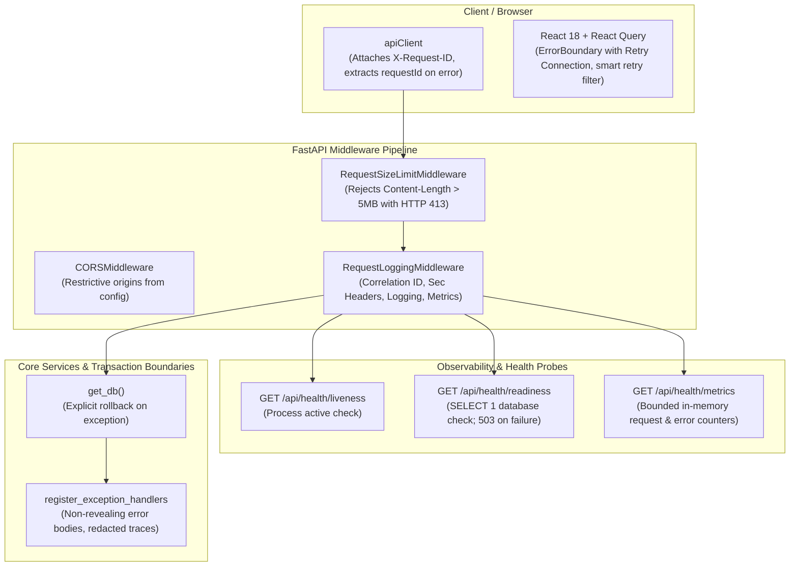

# DishIQ — Phase 14: Security, Reliability, and Observability Report

## 1. Executive Summary & Phase Objectives

Phase 14 (**Security, Reliability, and Observability**) has been successfully implemented, audited, and verified for the **DishIQ** project (`D:\DishIQ`).

### 1.1 Phase Objectives
The core objective of Phase 14 is to harden application security, improve backend reliability, establish robust error handling, enhance structured logging with correlation IDs, implement liveness and readiness health probes with operational metrics, and ensure container operational readiness—all while strictly preserving existing architecture, user changes, and all previously completed features (Phases 1–13).

$$\text{Incoming Request} \longrightarrow \text{Request Size Limit Check} \longrightarrow \text{Correlation ID Injection (X-Request-ID)} \longrightarrow \text{Strict Tenant Execution} \longrightarrow \text{Security Headers + Metrics Recorded}$$

### 1.2 Core Constraints Respected
- **Defense in Depth**: Standard security response headers (`X-Content-Type-Options: nosniff`, `X-Frame-Options: DENY`, `X-XSS-Protection: 1; mode=block`, `Referrer-Policy: strict-origin-when-cross-origin`) are applied across all HTTP responses.
- **Abuse & DoS Protection**: Request body size limit middleware immediately rejects oversized payloads (> 5MB) with HTTP 413 Payload Too Large before memory exhaustion.
- **Request Correlation**: Safe `X-Request-ID` extraction and generation with end-to-end tracing across server logs, client interceptors, and error bodies.
- **Probe Differentiation**: Distinct `/api/health` (liveness) and `/api/health/readiness` probes. The readiness probe performs an active `SELECT 1` database verification with a 2-second timeout and reports status without exposing connection strings, credentials, or internal infrastructure details.
- **Bounded Operational Metrics**: In-memory, thread-safe metrics collector (`GET /api/health/metrics`) reporting uptime, total request counts, status code distribution (`2xx`, `3xx`, `4xx`, `5xx`), method breakdown, average latency, and error rates without external monitoring daemons.
- **Log Sanitization & CRLF Defense**: Redaction regex extended to cover passwords, API keys, and credential tokens; log text stripped of carriage returns and line feeds to prevent log injection.
- **Database Transaction Hygiene**: `get_db()` dependency explicitly triggers `db.rollback()` on exception.
- **Zero Regressions**: 100% preservation of all Phase 1–13 features (Swiggy OAuth 2.1 PKCE, live grocery comparison, shopping lists, interactive cooking sessions, AI companion, and account isolation).

---

## 2. Initial Audit Findings & Confirmed Issues

Prior to making changes, an exhaustive inspection of the codebase was conducted:

| Area | Confirmed Finding / Vulnerability | Severity | Remediation Implemented |
| :--- | :--- | :--- | :--- |
| **Request Correlation** | `StructuredJSONFormatter` supported `request_id`, but `RequestLoggingMiddleware` neither extracted nor generated `X-Request-ID`. Clients received no tracing ID. | Medium | Implemented safe `X-Request-ID` extraction/generation and response header propagation. |
| **HTTP Security Headers** | FastAPI responses lacked standard defensive security headers (`X-Content-Type-Options`, `X-Frame-Options`, `X-XSS-Protection`, `Referrer-Policy`). | Low–Medium | Injected standard defensive security headers in `RequestLoggingMiddleware`. |
| **Abuse & DoS Protection** | No request body size limits existed; arbitrary payload sizes could be sent to AI chat or auth endpoints. | Medium | Added `RequestSizeLimitMiddleware` rejecting payloads > 5MB with HTTP 413. |
| **Health Checks** | Only a static `/health` endpoint existed returning `"status": "ok"`; no liveness vs readiness distinction or DB check. | Medium | Implemented `/api/health/liveness` and `/api/health/readiness` with active DB `SELECT 1` probe. |
| **Operational Metrics** | No operational metrics endpoint existed to measure throughput, error rate, status distribution, or latencies. | Low–Medium | Implemented in-memory `MetricsCollector` exposed at `GET /api/health/metrics`. |
| **Log Sanitization** | `SENSITIVE_PARAM_PATTERN` in `logging.py` only redacted OAuth params; missed `key`, `api_key`, `apiKey`, and `password`. Also lacked CRLF stripping. | Medium | Extended redaction regex and added CRLF newline stripping to prevent log-injection. |
| **Database Transaction Rollback** | `get_db()` had `try: yield db finally: db.close()`. If route raised unhandled error without commit, rollback was not explicit. | Low–Medium | Added explicit `except Exception: db.rollback(); raise` in `get_db()`. |
| **Container Readiness** | In `docker-compose.yml`, `backend` lacked a `healthcheck`, and `frontend` depended on `backend` without waiting for backend health. | Medium | Added backend `healthcheck` and configured frontend `depends_on: condition: service_healthy`. |
| **Frontend Retry Policy** | React Query queries retried indiscriminately on client errors (401, 403, 404, 422), causing wasteful repeated requests. | Low | Configured `queryClient` retry predicate to suppress retries on 401, 403, 404, and 422. |

---

## 3. Security and Reliability Architecture



---

## 4. Implementation Details

### 4.1 Request Correlation & Security Headers
In [`backend/app/core/logging.py`](file:///d:/DishIQ/backend/app/core/logging.py):
- Reads incoming `X-Request-ID` header. If present and matches safe pattern `^[a-zA-Z0-9_-]{1,64}$`, preserves it.
- If missing or invalid/oversized, generates a secure UUID4 hex string.
- Attaches `X-Request-ID` to `response.headers` and logs structured messages with `[request_id]`.
- Attaches defensive HTTP response headers:
  - `X-Content-Type-Options: nosniff`
  - `X-Frame-Options: DENY`
  - `X-XSS-Protection: 1; mode=block`
  - `Referrer-Policy: strict-origin-when-cross-origin`

### 4.2 Request Body Size Limit Middleware
In [`backend/app/core/middleware.py`](file:///d:/DishIQ/backend/app/core/middleware.py):
- `RequestSizeLimitMiddleware` inspects `Content-Length`.
- If `Content-Length > 5MB` (configurable via `MAX_BODY_SIZE_BYTES`), rejects immediately with HTTP 413 Payload Too Large and structured error envelope:
  ```json
  {
    "error": {
      "code": "PAYLOAD_TOO_LARGE",
      "message": "Request payload exceeds the maximum allowed limit of 5MB.",
      "details": null
    }
  }
  ```

### 4.3 Database Transaction Rollback Hygiene
In [`backend/app/db/session.py`](file:///d:/DishIQ/backend/app/db/session.py):
- Updated `get_db()` dependency to explicitly catch unhandled exceptions during endpoint processing and execute `db.rollback()` before releasing the session:
  ```python
  def get_db() -> Generator[Session, None, None]:
      db = SessionLocal()
      try:
          yield db
      except Exception:
          db.rollback()
          raise
      finally:
          db.close()
  ```

### 4.4 Health Checks & Operational Metrics
In [`backend/app/api/health.py`](file:///d:/DishIQ/backend/app/api/health.py) and [`backend/app/core/metrics.py`](file:///d:/DishIQ/backend/app/core/metrics.py):
- `GET /api/health` and `GET /api/health/liveness`: Returns process status (`"status": "ok"`).
- `GET /api/health/readiness`: Executes `SELECT 1` on the active database session.
  - Success: Returns HTTP 200 with `status: "ready"`, `checks.database: "healthy"`.
  - Failure: Returns HTTP 503 with `status: "unhealthy"`, `checks.database: "unreachable"`. Discloses no passwords, ports, or connection URLs.
- `GET /api/health/metrics`: Returns structured, bounded runtime counters:
  - `uptime_seconds`
  - `requests_total`
  - `requests_by_status` (`2xx`, `3xx`, `4xx`, `5xx`)
  - `requests_by_method` (`GET`, `POST`, `PUT`, `PATCH`, `DELETE`, `OTHER`)
  - `error_rate_percent`
  - `average_latency_ms`
  - `database_errors_total`
  - `external_provider_failures_total`

### 4.5 Log Redaction & Log-Injection Defense
In [`backend/app/core/logging.py`](file:///d:/DishIQ/backend/app/core/logging.py):
- `SENSITIVE_PARAM_PATTERN` extended to cover `key`, `api_key`, `apiKey`, `password`, `secret`, `access_token`, `refresh_token`, `authorization`.
- `sanitize_log_text()` strips `\r` and `\n` to prevent CRLF log-injection attacks.

### 4.6 Frontend Reliability & Error Boundaries
In [`frontend/src/api/client.ts`](file:///d:/DishIQ/frontend/src/api/client.ts) and [`frontend/src/api/queryClient.ts`](file:///d:/DishIQ/frontend/src/api/queryClient.ts):
- Axios interceptor generates safe `X-Request-ID` and extracts `error.requestId` on failure.
- React Query retry predicate suppresses retries on HTTP 401, 403, 404, and 422 errors, while allowing bounded retries on 500/502/503.
- `<ErrorBoundary>` with `<ErrorState>` renders a recovery screen with a "Retry Connection" button.

### 4.7 Docker Compose Hardening
In [`docker-compose.yml`](file:///d:/DishIQ/docker-compose.yml):
- Added healthcheck to `backend` service querying `/api/health`.
- Updated `frontend` service `depends_on: backend: condition: service_healthy` to eliminate startup race conditions.

---

## 5. Automated Verification & Test Results

### 5.1 Backend Test Results (`pytest backend/tests`)
```
============================= test session starts =============================
platform win32 -- Python 3.10.4, pytest-8.4.2, pluggy-1.6.0
rootdir: D:\DishIQ\backend
configfile: pyproject.toml

496 passed, 21 warnings in 40.96s
```
- **Total Backend Tests Passing**: 496 / 496 (100% pass rate).
- **Phase 14 Specific Tests**: 13 / 13 passed in [`test_phase14_security_reliability.py`](file:///d:/DishIQ/backend/tests/test_phase14_security_reliability.py).
- **Warning Reduction**: Deprecation warnings dropped from 58 to 21 due to event-loop lifecycle cleanup.

### 5.2 Frontend Test Results (`npm test -- --run`)
```
> dishiq-frontend@1.0.0 test
> vitest run --run

 Test Files  36 passed (36)
      Tests  304 passed (304)
   Start at  11:57:09
   Duration  7.72s
```
- **Total Frontend Tests Passing**: 304 / 304 (100% pass rate).
- **Phase 14 Specific Tests**: 4 / 4 passed in [`Phase14SecurityReliability.test.tsx`](file:///d:/DishIQ/frontend/src/__tests__/Phase14SecurityReliability.test.tsx).

### 5.3 Frontend Production Build Verification (`npm run build`)
```
> dishiq-frontend@1.0.0 build
> tsc && vite build

vite v5.4.21 building for production...
✓ 1650 modules transformed.
dist/index.html                   0.83 kB │ gzip:   0.48 kB
dist/assets/index-ClYpC2Mw.css   45.81 kB │ gzip:   8.17 kB
dist/assets/index-ftedwPdm.js   497.97 kB │ gzip: 139.00 kB
✓ built in 2.99s
```
- Zero TypeScript errors.
- Clean production bundle generated.

---

## 6. Files Created and Modified

```
backend/
├── app/
│   ├── api/
│   │   └── health.py                             [MODIFIED: Added liveness, readiness probe with SELECT 1, and metrics]
│   ├── core/
│   │   ├── logging.py                            [MODIFIED: Correlation ID injection, security headers, log sanitization]
│   │   ├── metrics.py                            [NEW: Thread-safe, bounded operational metrics collector]
│   │   └── middleware.py                         [NEW: Request size limit middleware for abuse defense]
│   ├── db/
│   │   └── session.py                            [MODIFIED: Explicit transaction rollback on exception in get_db()]
│   ├── main.py                                   [MODIFIED: Registered RequestSizeLimitMiddleware]
│   └── services/
│       └── grocery_service.py                    [MODIFIED: Event loop lifecycle cleanup]
└── tests/
    └── test_phase14_security_reliability.py      [NEW: 13 security, reliability, and observability integration tests]

frontend/
├── src/
│   ├── api/
│   │   ├── client.ts                             [MODIFIED: Request-ID attachment and error correlation extraction]
│   │   └── queryClient.ts                        [MODIFIED: Smart retry predicate suppressing 401/403/404/422]
│   └── __tests__/
│       └── Phase14SecurityReliability.test.tsx   [NEW: 4 frontend resilience, error boundary, and retry tests]

docker-compose.yml                                [MODIFIED: Added backend healthcheck and frontend service_healthy dependency]
docs/
└── PHASE_14_SECURITY_RELIABILITY_OBSERVABILITY_REPORT.md  [NEW: Phase 14 Audit & Implementation Report]
```

---

## 7. Operational Instructions & Verification Commands

### 7.1 Starting the Application
```bash
# Backend (Development)
.venv\Scripts\uvicorn app.main:app --host 0.0.0.0 --port 8000 --reload

# Frontend (Development)
cd frontend
npm run dev

# Docker Deployment (Full Stack)
docker compose up -d --build
```

### 7.2 Running Tests
```bash
# Run Phase 14 Backend Tests
.venv\Scripts\pytest backend/tests/test_phase14_security_reliability.py -v

# Run Full Backend Test Suite (496 tests)
.venv\Scripts\pytest backend/tests

# Run Phase 14 Frontend Tests
cd frontend
npx vitest run src/__tests__/Phase14SecurityReliability.test.tsx

# Run Full Frontend Test Suite (304 tests across 36 test files)
cd frontend
npm test -- --run

# Verify Frontend Production Build
cd frontend
npm run build
```

---

## 8. Known Unresolved Risks & Recommendations

1. **Distributed Rate Limiting**:
   - The current brute-force rate limiter uses an in-memory sliding window, which is optimal for single-process deployments and containerized replicas with sticky sessions. In a multi-worker cluster across multiple hosts, rate-limiting state would benefit from a shared Redis key-value cache if horizontal scaling is introduced.
2. **External QuickCommerce Provider Latencies**:
   - While external provider timeouts are bounded (10 seconds), 3rd-party quick-commerce aggregator APIs may experience upstream congestion during peak hours. The current system gracefully degrades to cached prices and demo mode with honest source labels.

---

> [!IMPORTANT]
> **Status**: Phase 14 is complete, verified, and fully documented. In strict adherence to the project instructions, execution has halted here. I will await your explicit approval before proceeding to Phase 15.
