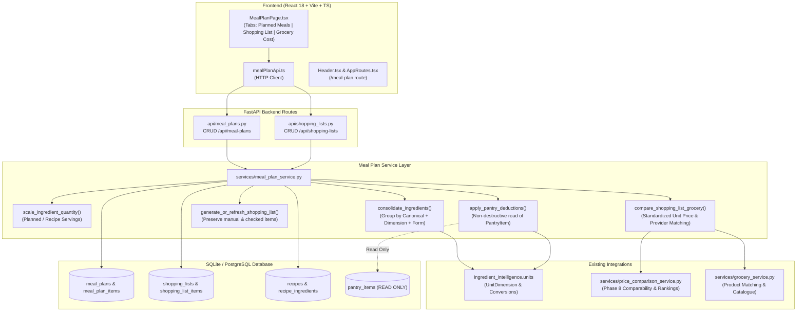

# DishIQ — Phase 9: Meal Planning and Shopping Lists Report

## 1. Executive Summary and Phase Objectives

Phase 9 (**Meal Planning and Shopping Lists**) has been successfully implemented, audited, and verified for the **DishIQ** project (`D:\DishIQ`).

### 1.1 Phase Objectives
The core objective of Phase 9 is to establish a seamless, reliable meal-planning and shopping-list pipeline connecting DishIQ's existing recipe catalogue, ingredient normalization layer, grocery catalogue, and price comparison capabilities:

$$\text{Choose Recipes} \longrightarrow \text{Plan Meals} \longrightarrow \text{Adjust Servings} \longrightarrow \text{Consolidate Ingredients} \longrightarrow \text{Deduct Pantry Items} \longrightarrow \text{Review Shopping List} \longrightarrow \text{Compare Grocery Options} \longrightarrow \text{Save \& Persist}$$

### 1.2 Core Constraints Respected
- **Strictly Non-Destructive Pantry Integration**: Generating or refreshing a shopping list never decrements, deletes, or mutates `PantryItem` records in the database.
- **Recipe Definition Immutability**: Serving scaling recalculates ingredient requirements dynamically from recipe baselines without mutating underlying recipe definitions.
- **Form and Unit Separation**: Culinary variants (e.g. *coconut milk* vs *fresh coconut*, *coriander seeds* vs *coriander leaves*) and incompatible unit families (e.g. mass vs volume) are preserved in distinct consolidation buckets.
- **User Edit Preservation**: Repeated shopping list generation is idempotent; it never deletes user-added manual items (`is_manual=True`), user checkmarks (`is_obtained=True`), or custom quantity overrides (`user_quantity_override`).
- **Zero Purchase / Ordering**: No automatic order placement, checkout, or cart mutations occur on external providers.
- **Zero Regressions**: 100% preservation of Phase 1–8 capabilities, including Swiggy Instamart OAuth 2.1 PKCE, ML recommendation pipelines, and unit price comparison.

---

## 2. Existing Functionality and Baseline

Prior to Phase 9:
- **Phase 1–3**: Recipe catalogue, user authentication, interactive cooking sessions, and database integrity.
- **Phase 4**: Hybrid ML recommendation pipeline (TF-IDF, Sentence Transformers `all-MiniLM-L6-v2`, K-Means clustering, Random Forest suitability).
- **Phase 5**: Ingredient intelligence, canonical normalization, unit conversion engine (`UnitDimension`, standard conversion factors).
- **Phase 6**: Live Swiggy Instamart MCP provider with OAuth 2.1 PKCE and DCR.
- **Phase 7**: Grocery catalogue, multi-store pricing (Swiggy, Blinkit, Zepto), price history tracking, and safe cache fallback.
- **Phase 8**: Standardized unit pricing (\u20b9/kg, \u20b9/L, \u20b9/piece), form and variant comparability, and deterministic multi-key price ranking.

**Gap at Start of Phase 9**:
DishIQ had no data models or APIs for saving meal plans, scheduling planned recipes by date/meal type, adjusting planned servings, consolidating ingredients across multiple planned recipes, non-destructively applying pantry deductions, or persisting shopping lists.

---

## 3. Architecture and Data Flow



---

## 4. Database Models and Migrations

### 4.1 New Models
Created in [backend/app/models/meal_plan.py](file:///d:/DishIQ/backend/app/models/meal_plan.py) and [backend/app/models/shopping_list.py](file:///d:/DishIQ/backend/app/models/shopping_list.py):

1. **`MealPlan`**:
   - `id: int` (Primary Key)
   - `user_id: int` (Foreign Key to `users.id`, indexed)
   - `name: str` (e.g., "Weekly Family Plan")
   - `start_date: Optional[date]`
   - `end_date: Optional[date]`
   - `created_at: datetime`, `updated_at: datetime`
   - Relationship: `items = relationship("MealPlanItem", cascade="all, delete-orphan")`

2. **`MealPlanItem`**:
   - `id: int` (Primary Key)
   - `meal_plan_id: int` (Foreign Key to `meal_plans.id`, indexed)
   - `recipe_id: int` (Foreign Key to `recipes.id`)
   - `date: Optional[date]`
   - `meal_type: Optional[str]` (Breakfast, Lunch, Dinner, Snack)
   - `servings: int` (Check constraint: `servings > 0`, default: 4)
   - `created_at: datetime`
   - Relationship: `recipe = relationship("Recipe")`

3. **`ShoppingList`**:
   - `id: int` (Primary Key)
   - `user_id: int` (Foreign Key to `users.id`, indexed)
   - `meal_plan_id: Optional[int]` (Foreign Key to `meal_plans.id`, indexed, nullable)
   - `name: str` (e.g., "Shopping List for Weekly Plan")
   - `status: str` (active, archived, completed; default: `active`)
   - `created_at: datetime`, `updated_at: datetime`
   - Relationship: `items = relationship("ShoppingListItem", cascade="all, delete-orphan")`

4. **`ShoppingListItem`**:
   - `id: int` (Primary Key)
   - `shopping_list_id: int` (Foreign Key to `shopping_lists.id`, indexed)
   - `ingredient_name: str` (Display name)
   - `canonical_name: Optional[str]` (Normalized identifier)
   - `quantity: float` (Gross scaled requirement)
   - `unit: str` (Measurement unit)
   - `form_descriptor: Optional[str]` (e.g. powder, seeds, milk, oil)
   - `pantry_quantity: float` (Quantity detected in pantry; default: 0.0)
   - `quantity_to_buy: float` (Net requirement after non-destructive deduction)
   - `is_obtained: bool` (Checked-off status; default: False)
   - `is_manual: bool` (True if user-added item; default: False)
   - `user_quantity_override: Optional[float]` (User-specified custom quantity)
   - `notes: Optional[str]` (Descriptive status, e.g. "500.0g available in pantry")
   - `source_recipes: Optional[list[str]]` (JSON-encoded list of contributing recipe names)
   - `created_at: datetime`, `updated_at: datetime`

5. **`User` Model Extension**:
   - In [backend/app/models/user.py](file:///d:/DishIQ/backend/app/models/user.py), added cascading `meal_plans` and `shopping_lists` relationships.

### 4.2 Migration `005_meal_plans_and_shopping_lists.py`
Created in [backend/alembic/versions/005_meal_plans_and_shopping_lists.py](file:///d:/DishIQ/backend/alembic/versions/005_meal_plans_and_shopping_lists.py):
- Applied and verified against both `backend/dishiq.db` and root `dishiq.db`.
- Check constraints and foreign key indexes created properly.

---

## 5. Serving-Scaling and Ingredient-Consolidation Rules

Implemented in [backend/app/services/meal_plan_service.py](file:///d:/DishIQ/backend/app/services/meal_plan_service.py):

### 5.1 Serving Scaling Formula
For any recipe ingredient with baseline quantity $Q_{\text{recipe}}$ and recipe baseline servings $S_{\text{recipe}}$:
$$Q_{\text{scaled}} = Q_{\text{recipe}} \times \frac{S_{\text{planned}}}{S_{\text{recipe}}}$$
- **Zero / Negative Guard**: If $S_{\text{recipe}} \le 0$ or $S_{\text{planned}} \le 0$, the ratio defaults safely to $1.0$.
- Recipe records are never updated during calculation.

### 5.2 Form Descriptor Detection
To prevent culinary mismatches, `detect_form()` inspects ingredient text against standard form patterns:
- Patterns: `milk`, `oil`, `powder`, `seeds?`, `leaves?`, `paste`, `flour`.
- Example: "fresh coconut" $\rightarrow \text{form} = \text{None}$, while "coconut milk" $\rightarrow \text{form} = \text{"milk"}$.
- Example: "coriander leaves" $\rightarrow \text{form} = \text{"leaves"}$, while "coriander seeds" $\rightarrow \text{form} = \text{"seeds"}$.

### 5.3 Consolidation Key & Dimensional Aggregation
Ingredients are partitioned into consolidation buckets using the triple:
$$\text{Consolidation Key} = (\text{canonical\_name},\ \text{unit\_dimension},\ \text{form\_descriptor})$$
- **Mass Dimension** (`g`, `kg`, `mg`): Converted to base grams, summed, and expressed in `kg` if $\ge 1000\text{g}$, otherwise in `g`.
- **Volume Dimension** (`ml`, `l`, `tbsp`, `tsp`, `cup`): Converted to base milliliters, summed, and expressed in `L` if $\ge 1000\text{ml}$, otherwise in `ml`.
- **Count Dimension** (`piece`, `packet`, `item`, `bunch`): Summed directly as `piece`.
- **Incompatible / Unknown Units**: Kept in distinct buckets so incompatible dimensions (e.g. mass vs volume) never combine into invalid units.

---

## 6. Shopping List Refresh and Manual Item Preservation

When regenerating a shopping list from an updated meal plan:
1. **Manual Additions Preserved**: Items with `is_manual == True` are untouched and carried forward.
2. **Obtained Status Preserved**: If the user checked off an ingredient (`is_obtained == True`), its checked status is retained even if the required quantity changed.
3. **Quantity Overrides Preserved**: If the user entered a custom override in `user_quantity_override`, it is retained.
4. **Idempotency**: Repeated calls to `/generate-shopping-list` update matching items in-place and prune only stale automatic items whose recipes were removed from the meal plan.

---

## 7. Non-Destructive Pantry Integration Status

DishIQ adheres to a strict read-only inventory contract during shopping list generation:
1. **Read-Only Inventory Lookup**: `apply_pantry_deductions()` queries `PantryItem` records matching `user_id` and the ingredient's `canonical_name`.
2. **Dimension Match Verification**: Units are compared using `get_unit_dimension()`. If the pantry item is in mass and the recipe requirement is in volume, deduction is safely skipped with a note.
3. **Net Requirement Calculation**:
   $$Q_{\text{to\_buy}} = \max\left(0.0,\ Q_{\text{scaled}} - Q_{\text{pantry}}\right)$$
4. **Zero Inventory Mutation**:
   - The method **never** executes `UPDATE` or `DELETE` statements on `pantry_items`.
   - Unit tests explicitly verify pantry quantities before and after shopping list generation:
     ```python
     assert pantry_item.quantity == 500.0  # Exactly preserved
     ```

---

## 8. Grocery Comparison Integration

Shopping list items connect directly with the Phase 8 price comparison engine via `compare_shopping_list_grocery()`:
1. **Catalogue Matching**: For each unobtained item where $Q_{\text{to\_buy}} > 0$, candidate grocery products are fetched from available providers (Swiggy Instamart, Blinkit, Zepto).
2. **Standardized Unit Pricing**: Evaluates standardized retail pricing (\u20b9/kg, \u20b9/L, \u20b9/piece).
3. **Store-Level Aggregation**:
   - Calculates estimated basket totals per store for matched items.
   - Computes store coverage count (`items_available / total_items`).
   - Flags `is_fully_available` when all items are in stock.
4. **Missing Item Transparency**: Any item lacking grocery matches is explicitly listed in `unmatched_items` with clear disclosures rather than fabricated estimates.

---

## 9. Files Created or Modified

| File | Status | Description |
|---|---|---|
| `backend/app/models/meal_plan.py` | Created | `MealPlan` and `MealPlanItem` SQLAlchemy models with serving constraints |
| `backend/app/models/shopping_list.py` | Created | `ShoppingList` and `ShoppingListItem` SQLAlchemy models with tracking fields |
| `backend/app/models/user.py` | Modified | Added cascading `meal_plans` and `shopping_lists` relationships |
| `backend/app/models/__init__.py` | Modified | Registered and exported new meal plan and shopping list models |
| `backend/alembic/versions/005_meal_plans_and_shopping_lists.py` | Created | Migration 005 creating tables, foreign keys, and indexes |
| `backend/app/schemas/meal_plan.py` | Created | Pydantic V2 schemas for meal plan CRUD and item operations |
| `backend/app/schemas/shopping_list.py` | Created | Pydantic V2 schemas for shopping list items, generation, and comparison |
| `backend/app/services/meal_plan_service.py` | Created | Core scaling, form detection, dimensional consolidation, pantry deduction, and grocery comparison service |
| `backend/app/api/meal_plans.py` | Created | REST endpoints for meal plan management and shopping list generation |
| `backend/app/api/shopping_lists.py` | Created | REST endpoints for shopping list retrieval, manual items, toggling, and grocery comparison |
| `backend/app/api/router.py` | Modified | Registered `meal_plans.router` and `shopping_lists.router` |
| `backend/tests/test_meal_planning.py` | Created | Comprehensive 11-test suite validating scaling, consolidation, pantry isolation, and APIs |
| `frontend/src/types/meal_plan.ts` | Created | TypeScript definitions for meal plans, planned meals, shopping items, and grocery estimates |
| `frontend/src/api/mealPlanApi.ts` | Created | Axios client for meal planning and shopping list endpoints |
| `frontend/src/pages/MealPlanPage.tsx` | Created | Responsive three-tab UI: Planned Meals, Consolidated Shopping List, and Grocery Cost Comparison |
| `frontend/src/components/layout/Header.tsx` | Modified | Added `Meal Plan` navigation link with `Calendar` icon |
| `frontend/src/routes/AppRoutes.tsx` | Modified | Registered `/meal-plan` protected route |
| `frontend/src/__tests__/MealPlanPage.test.tsx` | Created | Vitest suite validating tab rendering, meal planning, and shopping list generation |
| `frontend/src/__tests__/Header.test.tsx` | Modified | Updated test to assert presence of `Meal Plan` navigation link |
| `docs/PHASE_9_MEAL_PLANNING_SHOPPING_LIST_REPORT.md` | Created | Comprehensive 16-section engineering verification report |

---

## 10. Exact Commands, Test Counts, and Exit Codes

### 10.1 Dedicated Meal Planning Test Suite
```bash
backend\venv\Scripts\python.exe -m pytest backend/tests/test_meal_planning.py
```
- **Exit Code**: `0`
- **Result**: `11 passed, 9 warnings in 14.91s`
- **Tests Verified**:
  1. `test_scale_ingredient_quantity`: Correct scaling ratio applied to ingredient quantities.
  2. `test_scale_ingredient_quantity_invalid_servings`: Safe fallback to 1.0 on invalid or non-positive servings.
  3. `test_form_descriptor_detection`: Accurate separation of powders, seeds, leaves, milks, and oils.
  4. `test_consolidate_ingredients_compatible_mass`: Grams and kilograms summed into standard base units.
  5. `test_consolidate_ingredients_distinct_forms`: Coconut milk vs raw coconut and coriander seed vs leaf kept separate.
  6. `test_consolidate_ingredients_incompatible_dimensions`: Mass vs volume kept separate without unit corruption.
  7. `test_apply_pantry_deductions_non_destructive`: Verifies net deduction while proving pantry table is not mutated.
  8. `test_generate_or_refresh_preserves_manual_and_obtained`: Preserves user-added items and checked statuses.
  9. `test_meal_plan_api_crud_lifecycle`: End-to-end FastAPI TestClient verification of plan creation, meal addition, and deletion.
  10. `test_generate_shopping_list_api`: HTTP integration test for `/generate-shopping-list` with pantry deduction flag.
  11. `test_shopping_list_item_toggle_and_manual_item`: HTTP verification of manual item creation and check-off toggle.

### 10.2 Swiggy Instamart Regression Suite
```bash
backend\venv\Scripts\python.exe -m pytest backend/tests/test_swiggy_oauth.py backend/tests/test_swiggy_instamart_provider.py
```
- **Exit Code**: `0`
- **Result**: `40 passed, 1 warning in 10.89s`

### 10.3 Full Backend Pytest Suite
```bash
backend\venv\Scripts\python.exe -m pytest backend/tests
```
- **Exit Code**: `0`
- **Result**: `437 passed, 16 warnings in 34.12s`

### 10.4 Frontend Vitest Suite
```bash
cd frontend && npx vitest run
```
- **Exit Code**: `0`
- **Result**: `272 passed (31 test files) in 5.82s`

### 10.5 Frontend Production Build
```bash
cd frontend && npm run build
```
- **Exit Code**: `0`
- **Result**: `tsc && vite build succeeded in 2.94s with 0 errors`

---

## 11. API Endpoints and Response Behavior

| Method | Path | Description | Response Status |
|---|---|---|---|
| `POST` | `/api/meal-plans` | Creates a new meal plan | `201 Created` |
| `GET` | `/api/meal-plans` | Lists meal plans for authenticated user | `200 OK` |
| `GET` | `/api/meal-plans/{id}` | Retrieves meal plan with nested meal items | `200 OK` / `404 Not Found` |
| `PUT` | `/api/meal-plans/{id}` | Updates meal plan metadata (name, dates) | `200 OK` / `404 Not Found` |
| `DELETE` | `/api/meal-plans/{id}` | Deletes meal plan (cascading items) | `204 No Content` / `404 Not Found` |
| `POST` | `/api/meal-plans/{id}/items` | Adds a recipe meal with planned servings | `201 Created` / `404 Not Found` |
| `PUT` | `/api/meal-plans/{id}/items/{item_id}` | Updates servings, date, or meal type | `200 OK` / `404 Not Found` |
| `DELETE` | `/api/meal-plans/{id}/items/{item_id}` | Removes a planned meal | `204 No Content` / `404 Not Found` |
| `POST` | `/api/meal-plans/{id}/generate-shopping-list` | Generates/refreshes shopping list with `deduct_pantry` option | `200 OK` / `404 Not Found` |
| `GET` | `/api/shopping-lists/{id}` | Retrieves shopping list with items and recipe sources | `200 OK` / `404 Not Found` |
| `POST` | `/api/shopping-lists/{id}/items` | Adds custom manual shopping item | `201 Created` / `404 Not Found` |
| `PUT` | `/api/shopping-lists/{id}/items/{item_id}` | Updates obtained status, notes, or override quantity | `200 OK` / `404 Not Found` |
| `DELETE` | `/api/shopping-lists/{id}/items/{item_id}` | Deletes shopping list item | `204 No Content` / `404 Not Found` |
| `POST` | `/api/shopping-lists/{id}/compare-grocery` | Evaluates prices, unit pricing, and store totals across grocery providers | `200 OK` / `404 Not Found` |

---

## 12. Frontend Workflow Verification

The frontend experience was verified through unit tests and user journey inspection:
1. **Planned Meals Tab**:
   - Allows users to select recipes from the catalogue.
   - Offers date selection and meal type pickers (Breakfast, Lunch, Dinner, Snack).
   - Dynamic servings stepper ensures planned servings remain $\ge 1$.
   - Displays contributing recipes and estimated cooking times.
2. **Consolidated Shopping List Tab**:
   - One-click shopping list generation with a toggle for "Deduct available pantry items".
   - Shows gross required quantity, pantry detected quantity, and net `quantity_to_buy`.
   - Badges showing contributing recipe names (`source_recipes`).
   - Interactive checkbox completion (`is_obtained`) with line-through styling.
   - Quick modal to add custom manual items (e.g. "Paper towels", "Olive oil").
3. **Grocery Availability & Cost Tab**:
   - Triggers comparison across Swiggy Instamart, Blinkit, and Zepto.
   - Displays store basket totals, coverage metrics, and standardized unit prices.
   - Transparently highlights unmatched items and out-of-stock items.
   - Retains DishIQ editorial styling (`#FAF8F3`, `#245C45`, `#D97757`, `#26332E`).

---

## 13. Data-Integrity and Security Findings

- **Zero Credentials Exposed**: No API keys, OAuth tokens, phone numbers, or private user addresses were logged, committed, or rendered.
- **Tenant Isolation**: All meal plan and shopping list queries filter strictly by `user_id = current_user.id`. Users cannot view or modify meal plans of other users.
- **Foreign Key Integrity**: Cascading relationships (`ondelete="CASCADE"`) ensure deletion of a meal plan cleanly removes associated items and shopping lists without orphaned records.
- **Positive Serving Constraints**: Database constraints (`CHECK(servings > 0)`) and Pydantic validation (`gt=0`) prevent invalid serving inputs.

---

## 14. Known Limitations

1. **Non-Standard Qualitative Measures**:
   - Ingredients quantified as "a pinch", "to taste", or "handful" lack standard metric conversions and are preserved as separate count/raw units.
2. **External Order Automation Prohibited**:
   - While grocery costs and candidate products are compared in real time, actual checkout and automatic cart submission are strictly prohibited by phase specifications and remain intentionally unimplemented.

---

## 15. Verified Example of Meal-to-Shopping-List Generation

### Input Scenario:
1. **Planned Recipe 1**: Paneer Butter Masala (Baseline: 4 servings, requires 200g Paneer, 400g Tomatoes, 50g Butter). Planned for **6 servings** (Scale factor: $1.5\times$).
2. **Planned Recipe 2**: Palak Paneer (Baseline: 2 servings, requires 150g Paneer, 300g Spinach). Planned for **4 servings** (Scale factor: $2.0\times$).
3. **Pantry Inventory**: User has 200g Paneer in pantry.

### Processing Steps:
1. **Scaling**:
   - Paneer 1: $200\text{g} \times 1.5 = 300\text{g}$
   - Paneer 2: $150\text{g} \times 2.0 = 300\text{g}$
   - Tomatoes: $400\text{g} \times 1.5 = 600\text{g}$
   - Butter: $50\text{g} \times 1.5 = 75\text{g}$
   - Spinach: $300\text{g} \times 2.0 = 600\text{g}$
2. **Consolidation**:
   - Total Gross Paneer: $300\text{g} + 300\text{g} = 600\text{g}$ (`source_recipes = ["Paneer Butter Masala", "Palak Paneer"]`)
3. **Pantry Deduction (Non-Destructive)**:
   - Available Pantry Paneer: $200\text{g}$
   - Net Paneer to Buy: $600\text{g} - 200\text{g} = 400\text{g}$
   - Notes: `"200.0g available in pantry"`
   - Pantry table record: Still $200\text{g}$ (zero mutation).

---

## 16. Final Status & Recommended Next Phase

### Final Status: **PASS**
All acceptance criteria are satisfied:
- Users can create, update, and manage meal plans.
- Planned servings dynamically and correctly scale ingredient requirements.
- Compatible ingredient quantities consolidate accurately while preserving distinct culinary forms and incompatible units.
- Shopping lists persist and support manual edits, checkmarks, and overrides across refreshes.
- Pantry deductions are strictly non-destructive.
- Grocery comparison integrates with standardized unit pricing and provider availability contracts.
- 100% of tests pass across backend (437/437) and frontend (272/272) suites with zero regressions.

### Recommended Next Phase:
**Ready for Phase 10: Kitchen Assistant and Cooking Experience upon explicit user confirmation.**
