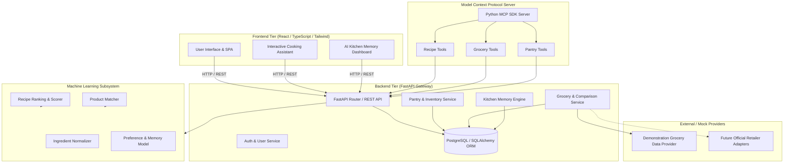
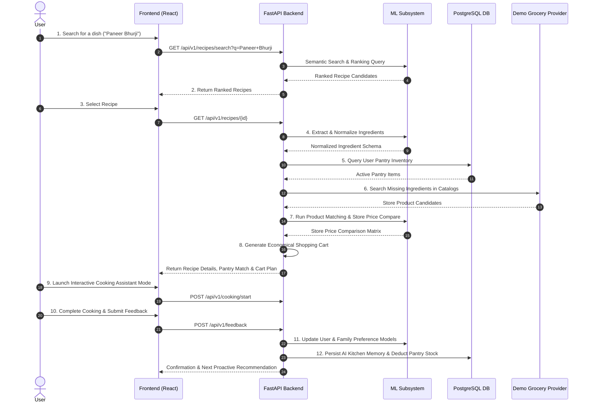

# DishIQ System Architecture & Design

## 1. Modular Architecture Overview

DishIQ is structured into four cleanly decoupled tiers:

1. **Frontend Tier (React + Vite + TypeScript + Tailwind CSS)**
   - Single Page Application (SPA) offering recipe search, grocery comparison dashboards, shopping list management, interactive cooking assistant UI, and AI Kitchen Memory settings.
2. **Backend Services Tier (Python + FastAPI + SQLAlchemy + PostgreSQL)**
   - RESTful API gateway handling business logic, session management, user preferences, pantry CRUD, and orchestration between ML services and database persistence.
3. **Machine Learning Subsystem (Scikit-learn + Sentence Transformers + Pandas + Joblib)**
   - Isolated ML services for recipe semantic vector embedding, smart ranking, ingredient NLP normalization, product match scoring, and preference decay learning.
4. **Model Context Protocol Tier (Python MCP SDK)**
   - Dedicated MCP tool server exposing structured tools (`search_recipes`, `compare_store_prices`, `get_pantry_inventory`) to AI assistants and LLM orchestrators.

---

## 2. System Architecture Diagram

---

## 3. Workflow Diagram (MVP 12-Step Pipeline)

---

## 4. Architectural Guarantees

1. **Demonstration Data Isolation**: Demo grocery pricing data is strictly isolated within mock providers. Live scraping of non-authorized grocery websites is prohibited.
2. **Stateless Backend**: FastAPI backend instance is stateless, allowing horizontal scaling. Session state is managed via secure tokens and database persistence.
3. **Model Decoupling**: ML models are loaded asynchronously and executed via standard Python service interfaces, allowing independent model upgrades without API breaking changes.
